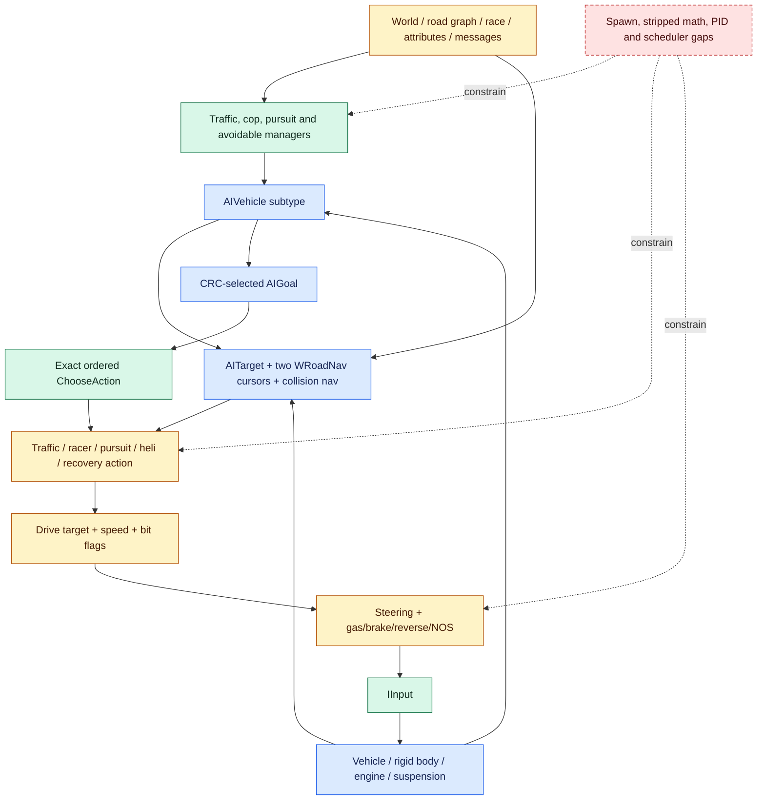

# Need for Speed: Most Wanted PC 1.3 full AI system reverse-engineering report

> Analysis date: 2026-09-11  
> Target: owner-operated PC 1.3 executable running in CrossOver  
> Report flavor: `null` — ordinary PE reverse engineering, no malware/APT/vulnerability overlay  
> Evidence model: Evidence → Finding → Path

> **Completion boundary:** the installed executable has been identified exactly,
> the complete zAI object range has been inventoried, and a broad architecture
> and behavior contract has been recovered. The AI is **not yet
> retail-equivalent**: 2,807 of 3,696 reported functions are unmatched, 2,730
> remain unidentified, several recovered bodies are stripped or empty, and one
> controlled mixed gameplay trace covers only nine selected anchors rather than
> full branch or scheduler policy. A broader 48-hook schema-3 tracer is
> statically ready but has not been installed or run. No Unity AI runtime code
> was changed.

## Executive summary

The installed `speed.exe` is byte-for-byte identical to the PC 1.3 oracle in
the local decompilation corpus. That establishes that the corpus symbols,
preferred-image addresses, and objdiff function records describe the executable
actually launched under CrossOver. A deterministic extractor mapped all 3,696
functions in the complete zAI preferred-image range
`[0x00401050, 0x00446a8f)`, retained all 250,735 code bytes, hashed all 53 AI
source/header files, and classified every function as exact, near, partial, or
unmatched.

The first immutable extraction (v1) captured 553 exact / 182 near / 152 partial
/ 2,809 unmatched functions. While synthesis was in progress, the active
upstream objdiff report improved. A second immutable extraction (v2), with the
same executable, symbol map, splits, source list, and 53-file source manifest,
captures 556 / 205 / 128 / 2,807. Only `report.json` changed among the four
top-level extractor inputs. This report uses v2 and preserves v1 as provenance
rather than silently replacing it.

The recovered design is a layered execution system. `AIVehicle` owns target,
two road-navigation cursors, collision navigation, spawn/simple-physics state,
and a latched drive intent. A CRC-selected `AIGoal` owns an ordered list of
`AIAction` objects; exact action selection excludes the current action and lets
the later eligible candidate win equal-score ties. Actions feed a separate
simulation phase through engine interfaces. Traffic, cops/pursuits, helicopter,
spawn, racer, and avoidable managers remain distinct ownership boundaries.

Strong exact anchors include vehicle construction/reset/simulation actuation,
goal action selection, racer and traffic lifecycle points, target acquisition,
avoidable-grid rebuilding, cop-manager dispatch, per-unit pursuit update, and
roadblock construction. The broad source-correlated algorithms cover racer
potential/NOS, traffic population, pursuit formations/tactics, helicopter
flight/search/strike/exit, road navigation, GPS, messages, attributes, and
capability interfaces.

A controlled CrossOver gameplay run on that exact image now adds 15,386
contiguous runtime records: 7,693 exact entry/exit pairs with zero reported
drops or decoder integrity errors. All nine instrumented anchors executed,
covering vehicle think/simulate, goal action choice, traffic and normal spawn,
pursuit-vehicle spawn, pursuit tasks, and formation updates. The capture
contains concrete action states, Boolean outcomes, spawn outputs, object-field
ranges, callback `dT` values, and sampling-derived call-count bounds.

Tracer 0.3.4/schema 3 is now statically ready for the next controlled evidence
phase. It expands the exact-target catalogue to 48 entry hooks grouped into
eight profiles, uses bounded raw-region reads with validity masks, embeds the
resolved manifest and loss/budget counters, and verifies the mutable header and
every complete record with unkeyed SHA-256-derived integrity digests. It is
entry-only and remains disabled and uninstalled, so this readiness result adds
no schema-3 reachability, return values, durations, or gameplay observations.

The main limit is equally important: the object report is explicitly
`complete=false`. The mixed trace does not isolate steering/actuator output,
racer potential/NOS, traffic quota/pooling/despawn, roadblocks, target
lifecycle, helicopter, GPS, stripped bodies, or complete scheduler policy.
Racer/math/steering methods remain stripped; pull-over construction is
inconsistent; the simple adaptive PID update is empty; GPS rendering is absent;
and 82,451 bytes of unidentified original code remain. The result is therefore
a fidelity-bounded engineering contract, not a reimplementation. The full
contract is
[Tools/AI/AI_SYSTEM_CONTRACT.md](Tools/AI/AI_SYSTEM_CONTRACT.md).

## Scope and authorization

The case is an offline, owner-operated analysis of the locally installed PC
executable and supplied local decompilation corpus. In scope were PE triage,
byte identity verification, complete zAI object inventory, static source/binary
correlation, bounded reuse of a previously captured startup observation, a
nine-anchor observation-only runtime tracer and controlled gameplay capture,
the static design/build/review of a 48-hook profile-scoped successor, and
documentation. Executable patching on disk, unrestricted instrumentation,
external targets, and network interaction were out of scope.

The scope contract is
[scope.md](</Users/tihan-nico/Documents/Codex/2026-09-11/se/reverse-skill/work/nfsmw-pc13-zai/scope.md>).
It records `authorization.status=granted`, `basis=own_system`,
`network.mode=offline`, and `ready_for_act=true`.

The decompilation worktree was treated as read-only. Its observed unrelated
dirty physics file was excluded from zAI source evidence. The project worktree
was already heavily dirty; this work added only the `Tools/AI` analysis package
and this report.

## Target identity and unit boundary

| Property | Observed value | Evidence |
|---|---|---|
| File | `speed.exe` | E-001 |
| Format | PE32 GUI, Intel 80386 | E-001 |
| Size | 6,029,312 bytes | E-001, E-002 |
| MD5 | `c0516b485065fabdd69579816b5df763` | E-001 |
| SHA-256 | `80774c2e5d619b4f120b48d4462896fd504c263399d203a238769cffde1d253c` | E-001, E-002 |
| Image base | `0x00400000` | E-001 |
| Entry point | RVA `0x003c4040`, VA `0x007c4040` | E-001 |
| Corpus relationship | byte-identical (`cmp` exit 0) | E-002 |
| zAI object unit | `main/Speed/Indep/SourceLists/zAI` | E-003 |
| zAI range | `[0x00401050, 0x00446a8f)` | E-003, E-004 |
| zAI code / data | 250,735 / 21,008 bytes | E-003, E-004 |
| Runtime mapping observed previously | `0x400000-0xa79000` | E-007 |
| Controlled gameplay capture | 15,386 records / 7,693 exact pairs / zero drops | E-010, E-011 |

The installed and corpus executables have the same size and SHA-256 and compare
byte-for-byte. The zAI range contains 3,696 address-sorted symbols and the
objdiff unit contains 3,696 report entries. Pairing the two by order gives
3,696/3,696 identical name-and-size pairs, including generic `sub_` entries.
This invariant is enforced by the extractor; it is not a best-effort symbol
join.

## Method

1. Record authorization, targets, exclusions, and evidence paths.
2. Identify and hash the installed PC 1.3 PE image.
3. Hash and byte-compare it with the corpus oracle.
4. Select the complete zAI objdiff unit, derive its preferred-image range, and
   validate the report/symbol name-and-size invariant.
5. Generate a deterministic ledger containing every function, source candidate,
   recovery class, owner, subsystem, source hash, recovery marker, and selected
   architecture anchor.
6. Read every zAI source/header owner and focused engine interfaces, message
   types, generated attribute call sites, and the already recovered pursuit
   contract.
7. Recover scheduler, goal/action, racer, traffic, spawn, navigation, target,
   steering, cop/pursuit, helicopter, GPS, controller, message, and attribute
   contracts while bounding every claim by function match class.
8. Preserve stripped, empty, unmatched, unidentified, and runtime-unobserved
   semantics as explicit gaps.
9. Build an observation-only nine-anchor tracer, require exact target/prologue
   validation, capture controlled gameplay, and decode entry/return pairs.
10. Reject schema-1 specialized labels whose offsets do not match the retail
    binary; re-decode bounded snapshots from constructor-validated layouts.
11. Regenerate static and runtime outputs into temporary directories, compare
    with the frozen artifacts, and run strict case review.
12. Expand the exact-target tracer to 48 entry hooks with profile presets,
    bounded reads, explicit loss/budget accounting, coherent close semantics,
    payload integrity, fail-closed installation, and adversarial static review;
    keep live behavior as a separate controlled gate.

No disassembler guesses were promoted over current checked-in source and
binary-match evidence. The source remains a recovery artifact rather than an
automatic proof of retail behavior when its owning function is partial,
unmatched, stripped, or empty.

### Recovery classification

| Class | Criterion | Count | Claim boundary |
|---|---:|---:|---|
| Exact | 100% objdiff match | 556 | Reported function machine code matches the oracle. |
| Near | at least 95%, below 100% | 205 | High-confidence behavior; inspect differences before identity claims. |
| Partial | above 0%, below 95% | 128 | Candidate structure/constants only. |
| Unmatched | 0% | 2,807 | Fidelity hole; no inferred substitute. |

The object-wide matched-function count is 15.04329% and matched-code count is
18.914791% (47,426 bytes); the aggregate fuzzy match is 61.799213%. Those figures describe
object matching, not behavioral completion.

## Complete inventory

### Identification classes

| Identification class | Functions | Meaning |
|---|---:|---|
| identified zAI or adjacent contract | 664 | AI-owned classes/functions correlated to current source or named contracts |
| identified engine contract | 75 | messages, attributes, and engine interfaces directly used by zAI |
| identified dependency | 227 | math, simulation, world, compiler, standard-library, or other dependent code |
| unidentified generic gap | 2,628 | original generic `sub_`-style function without recovered identity |
| unidentified named gap | 102 | named original function not yet assigned a validated contract |

There are 77 identified-but-unmatched functions totaling 3,105 bytes. The two
largest are `AIVehicleHuman::~AIVehicleHuman` (319 bytes) and
`AIPursuit::~AIPursuit` (297 bytes). The complete unidentified class contains
2,730 functions / 82,451 bytes.

### Coverage by AI subsystem

| Subsystem | Functions | Bytes | Weighted match | Exact / near / partial / unmatched |
|---|---:|---:|---:|---:|
| AI math | 3 | 683 | 98.275271% | 1 / 2 / 0 / 0 |
| Attribute contracts | 35 | 2,300 | 100.000000% | 35 / 0 / 0 / 0 |
| Core vehicle runtime | 143 | 21,283 | 90.892333% | 107 / 16 / 15 / 5 |
| Engine interfaces | 26 | 334 | 96.407186% | 24 / 0 / 0 / 2 |
| Goal/action framework | 26 | 2,387 | 94.984093% | 16 / 7 / 2 / 1 |
| Helicopter AI | 40 | 9,178 | 91.091416% | 18 / 9 / 12 / 1 |
| Messaging contracts | 6 | 582 | 100.000000% | 6 / 0 / 0 / 0 |
| Police and pursuit | 300 | 72,500 | 93.603430% | 133 / 125 / 39 / 3 |
| Racer AI | 26 | 9,438 | 92.138395% | 17 / 3 / 6 / 0 |
| Spawn admission | 8 | 2,383 | 92.229146% | 1 / 3 / 4 / 0 |
| Steering and control | 18 | 6,370 | 93.239397% | 9 / 5 / 3 / 1 |
| Targeting and road navigation | 33 | 6,176 | 96.144391% | 25 / 3 / 5 / 0 |
| Traffic AI | 67 | 13,103 | 92.791745% | 40 / 15 / 12 / 0 |
| Unidentified original code | 2,730 | 82,451 | 0.000000% | 0 / 0 / 0 / 2,730 |

Other ledger rows retain compiler/standard-library, simulation, world/road,
math/sim, inlined/free, and other identified dependencies. They were not
discarded from the complete function inventory.

## Recovered architecture



Editable sources:
[nfsmw-ai-callflow.mmd](Tools/AI/nfsmw-ai-callflow.mmd) and
[nfsmw-ai-vehicle-cycle.mmd](Tools/AI/nfsmw-ai-vehicle-cycle.mmd).

### Core vehicle runtime

`AIVehicle` is the central behavior object, not the global AI manager. It owns
queried engine capabilities, a tracked target, immediate and future
`WRoadNav` instances, collision-navigation state, one goal, spawn/simple-physics
state, desired target/speed, drive flags, and simulation tasks.

The runtime separates thinking from actuation. The near-matched think task
skips ordinary policy while paused or while a race is ending, clears the drive
mask, updates subtype/goal policy, and leaves outputs latched. Exact
`OnTaskSimulate` applies them through `IInput`. Observed flag bits are steering
1, longitudinal control 2, and reverse allowance 4; ordinary full movement uses
7. This split must survive a port even when implemented in one host frame.

The controlled trace observed both paths. Its 1,577 sampled simulation calls
bound total `OnTaskSimulate` calls to 201,729–201,856; 204 sampled think calls
bound total `OnTask` calls to 12,993–13,056. Runtime snapshots contained drive
masks 0, 3, and 7. Observed callback `dT` ranges were
0.0016666668–0.0083333338 for simulation and
0.0060416651–0.33333334 for think. These values validate path execution and
field layout, not the scheduler's causal policy or uninstrumented performance.

Common steering converts a destination vector into local forward/right control.
Common longitudinal control compares desired/actual speed, handles reverse and
handbrake state, and writes gas/brake. NOS remains an action/subtype decision.
World probes, avoidables, current/future road positions, lane state, and target
drivability constrain the destination.

Off-world actors may enter simple physics: direct velocity/pose steering and
road-elevation following replace the full input/vehicle simulation. Spawn,
unspawn, and respawn are explicit latches with reset behavior and a last-spawn
timer.

### Exact goal/action selection

Goals and actions use CRC factories. A goal owns its ordered candidate list and
one current action. Exact `AIGoal::ChooseAction`:

1. records whether the current action is finished and its score;
2. scans every non-current action in order;
3. accepts an eligible action if the current one was finished or the candidate
   score is greater than or equal to the running score;
4. keeps scanning, so the later eligible action wins an equal-score tie;
5. calls old `FinishAction`, assigns, then calls new `BeginAction`;
6. updates the resulting current action.

Low/high scores are 0.0/1.0; traffic, ram, and head-on-ram use 0.1, while
pursuit-off-road uses 0.01. Fourteen goal names are registered: none, traffic,
patrol, pursuit, stop-short, ram, PIT, pull-over, head-on ram, static roadblock,
flee pursuit, helicopter pursuit, helicopter exit, and racer. Pull-over is not
a clean independent recovery: its constructor is stripped and its factory
returns `AIGoalRam`.

Damage, unstuck, and jackknife use the high score. Airborne uses the low score
and can still replace an eligible equal-score action when it appears later in
the ordered list. Spline and Strafe are factory-registered but never eligible
and have empty updates. Jackknife is factory-registered and message-aware but
no recovered goal adds it.

The exact chooser executed 3,803 times in the capture. Exit states were traffic
3,516 times at score 0.1, race 200 times at score 0, and pursuit-off-road 87
times at score 0.01. The run observed none→traffic, none→race,
pursuit-off-road→race, race→pursuit-off-road, and race→traffic transitions. It
did not isolate an equal-score tie, so later-wins-equal remains a conclusion
from the exact machine-code-backed body.

### Racer AI

Racecar behavior owns race navigation/filtering, preparation/reset, adaptive
steering PID, fixed longitudinal PID, catch-up, skill, off-world simple physics,
and NOS decisions. The race action computes a cookie path, curvature, grip,
top-speed and acceleration potentials, player-relative performance, skill and
catch-up modifiers, turnaround, occlusion, and NOS state before emitting full
driving intent.

`AIVehicleRacecar::Update` and race-action admission are exact. The large
potential/update algorithms are partial. `MaybeSpawnRacer`, line intersection,
and curvature are stripped; separation recovery is suspicious. These gaps
block a claim of exact rubber-banding or racing-line reproduction.

### Traffic AI

Traffic vehicles use a 0.1-rate variable task and flags 3. Their action follows
traffic lanes, uses attribute-driven street/highway speeds with 35/55 mph
fallbacks, limits for curvature and cookie occlusion, selects look-ahead road
targets, and reacts to accident state and speed messages.

The shared avoidable manager runs a 0.25 fixed task and rebuilds a
sort-and-prune neighborhood structure. The traffic manager runs a 0.5 variable
task, owns up to ten traffic patterns, applies density modifiers and quotas,
selects models/routes, reuses pools, and spawns/despawns vehicles. Traffic
pull-over currently always returns false; accident time is decremented by a
literal 1 per update; an impossible `size() < 0` branch remains in recovered
source. These are preserved discrepancies, not normalized away.

Runtime tracing recorded 1,920 `SpawnTraffic` calls, of which 89 returned true,
alongside the 3,516 traffic-action chooser exits. This proves the manager spawn
and traffic action paths executed in the run; density, quota, route/model,
pooling, and despawn branch causes were not isolated.

### Spawn and road admission

`AISpawnManager` rotates through a shared 50-segment camera cache, scans 20
segments, and validates five slots per refresh. It checks road/lane validity,
decision nodes, camera/player/no-cop distances, visibility, existing vehicles,
and lane suitability, then can choose a cached segment/lane.

Static correlation is now strong: the subsystem is 92.229146% weighted,
`CheckSpawnPosition` is 97.844154% near, and `GetSpawnLocation` is 99.3125%
near. Runtime tracing recorded 54 location calls with three successes and nine
position checks with three acceptances. The successful outputs were segment/lane
830/3, 812/3, and 978/1 with time steps 0.164520263671875,
0.6930084228515625, and 0.7348785400390625; the exact accepted vectors are in
the capture analysis. The manager decoded consistently with 150/400 minimum and
maximum spawn distances. Four of eight functions remain partial, and three
examples do not establish full placement or timing policy.

### Target, navigation, steering, and GPS

`AITarget` has a global fixed-capacity registry of ten. Exact acquire overloads
track a simable, a point, or a point+direction. Unregistering a simable clears
dependent handles. Two road cursors preserve immediate and future road state;
collision navigation and `AISteer` helpers supply interception, separation,
wall, and edge forces. Several steering helper bodies are stripped and the key
separation/ram functions are partial.

GPS is a down/search/track state machine. Look-ahead is speed × 3 clamped to
20–80, catches up at 10 units per source-time unit, arrives inside 30, and uses
200 as the recovered default deviation. It emits finished/lost events. Render
behavior is absent, so the UI arrow is outside the recovered contract.

### Police and pursuit

The full subsystem is documented separately in
[Tools/Pursuit/PORT_CONTRACT.md](Tools/Pursuit/PORT_CONTRACT.md). In the full AI
architecture, `AICopManager` owns caches, patrols, pursuits, roadblocks,
explicit spawns, support queues, and teardown. Its exact task order is breaker
zones → patrols → pursuits → roadblocks → explicit spawns → support delay.
`AIPursuit` owns target lifecycle, sight, heat, bust/cooldown, requests,
formations, statistics, and unit release. Individual vehicles own goals,
formation offsets, tactics, visibility, sirens, and controls.

This report does not duplicate the deeper roadblock/spike/request/statistics
tables. Their recovered values and independent gaps remain authoritative in
the pursuit contract. The trace observed 11 pursuit-vehicle spawn attempts—ten
false followed by one true—plus 82 sampled pursuit tasks and 33 sampled
formation updates, bounding totals at 1,297–1,312 and 257–264 calls. Observed
fields included maximum heat 5, heat scale 1, breaker timer -1, busted-timer
task handle 140, formation-attempt count 0–1, and total pursuit time up to
17.9824886. The major integration holes remain admission branch causes, normal
named-car construction, scheduler policy, formation offsets/transitions, LOS,
infractions, terminal states, and several roadblock hooks.

### Helicopter AI

One global pointer identifies the active helicopter. Fuel is loaded from the
perpetrator's pursuit-level attributes and transitions to the exit goal at
zero. The helicopter reacquires the local player each update. Candidate LOS
uses hidden-state policy, a 75-unit visual sphere, attribute LOS distance with
250 fallback, a forward test, tunnel/world obstruction, and a last-known-point
grace.

The flight adapter predicts pose, compensates for target velocity, avoids the
camera, filters against helicopter elevation sheets, chooses acceleration and
vertical correction, and sends desired velocity/facing to simple-chopper
physics. Pursuit modes are straight chase, search pattern, skid-hit approach,
and skid-hit strike. Exit rises, travels ahead, then behind/outside the player,
finishing only high, behind, and more than 150 units away.

Fuel and some boundaries are exact, but LOS/flight/chase/strike/exit are mostly
partial. No controlled helicopter scenario was observed.

### Messages, attributes, and interfaces

The system uses capability interfaces rather than one concrete vehicle type.
The recovered outer seams include `IVehicleAI`, `IInput`, `IRigidBody`,
`IEngine`, `ITransmission`, `ISuspension`, `IRacer`, `ITrafficAI`, `IPursuit`,
`IPursuitAI`, `IPerpetrator`, `ICopMgr`, `ITrafficMgr`, `ITrafficCenter`, and
`IAIHelicopter`. Missing required interfaces normally make an action
ineligible. Mechanic changes trigger re-querying.

Exact generated contract names used by zAI include `MSetTrafficSpeed`,
`MSetCopsEnabled`, `MSetCopAutoSpawnMode`, `MForcePursuitStart`, `MReqBackup`,
`MReqRoadBlock`, `MUnspawnCop`, `MBreakerStopCops`, `MControlPathfinder`,
`MJackKnife`, `MNotifyPlayerRep`, `MNotifyPursuitLength`, `MPerpBusted`, and
`MPerpEscaped`, plus `EEnableAIPhysics`, `EGPSFinished`, `EGPSLost`, and
`EMomentStrm`.

Generated `aivehicle`, `trafficpattern`, vehicle/chassis/tires/rigid-body/NOS,
`pursuitescalation`, `pursuitlevels`, `pursuitsupport`, and `smackable`
attributes own live configuration. Literals in the recovered algorithms are
fallbacks or local constants, not permission to replace authoritative data.

## High-value binary anchors

| Function | VA | Bytes | Match | Class |
|---|---:|---:|---:|---|
| `AIVehicle::Construct` | `0x0043cf40` | 107 | 100% | exact |
| `AIVehicle::ResetInternals` | `0x00414ce0` | 194 | 100% | exact |
| `AIVehicle::OnTaskSimulate` | `0x004081e0` | 52 | 100% | exact |
| `AIVehicle::OnTask` | `0x004082d0` | 158 | 95.35714% | near |
| `AIVehicle::SetGoal` | `0x00422480` | 391 | 79.35433% | partial |
| `AIVehicle::UpdateRoads` | `0x00442420` | 1,606 | 92.47321% | partial |
| `AIGoal::ChooseAction` | `0x0042b070` | 178 | 100% | exact |
| `AIVehicleRacecar::Update` | `0x0042aa80` | 189 | 100% | exact |
| `AIActionRace::CanBeAttempted` | `0x004076b0` | 217 | 100% | exact |
| `AIActionRace::Update` | `0x00428720` | 2,718 | 86.91922% | partial |
| `AITrafficManager::OnTask` | `0x00439cd0` | 32 | 100% | exact |
| `AITrafficManager::SpawnTraffic` | `0x00439a10` | 406 | 99.333336% | near |
| `AIVehicleTraffic::StartDriving` | `0x00423190` | 392 | 100% | exact |
| `AIAvoidable::UpdateAllAvoidables` | `0x0043a810` | 391 | 100% | exact |
| `AICopManager::OnTask` | `0x0043ef00` | 109 | 100% | exact |
| `AICopManager::SpawnPursuitIVehicle` | `0x00430e60` | 1,536 | 83.846695% | partial |
| `AIPursuit::OnTask` | `0x00443ba0` | 4,415 | 97.876434% | near |
| `AIPursuit::UpdateFormation` | `0x00443300` | 2,207 | 96.05457% | near |
| `AIVehiclePursuit::Update` | `0x0042ac90` | 184 | 100% | exact |
| `AIVehicleCopCar::WatchForPerps` | `0x0042f570` | 184 | 100% | exact |
| `AIRoadBlock::Construct` | `0x0043db80` | 131 | 100% | exact |
| `AIVehicleHelicopter::Update` | `0x0042adb0` | 288 | 89.89109% | partial |
| `AIActionHeliPursuit::Update` | `0x004277e0` | 271 | 81.7875% | partial |
| `AISpawnManager::GetSpawnLocation` | `0x0042fa40` | 360 | 99.3125% | near |
| `AISpawnManager::CheckSpawnPosition` | `0x00419fc0` | 440 | 97.844154% | near |
| `AITarget::TrackAll` | `0x004237f0` | 62 | 100% | exact |
| `AISteer::Separation` | `0x0040a390` | 154 | 34.018867% | partial |
| `AISteer::Ram` | `0x00418200` | 900 | 99.88278% | near |
| `Gps::Update` | `0x0042c390` | 815 | 95.05242% | near |
| `Gps::Engage` | `0x0042c6c0` | 354 | 95.12613% | near |

The frozen ledger contains all selected anchors, including overloads, rather
than only this compact table.

## Dynamic evidence boundary

The historical bounded observation in E-007 established process creation,
preferred-base mapping at `0x400000-0xa79000`, D3DMetal selection, startup
liveness, and bounded shutdown for this exact executable. It contained no AI
gameplay evidence and remains an immutable startup-only record.

E-010/E-011 add a controlled owner-played run through an observation-only ASI.
The run began at `2026-09-11T14:16:10.087695Z` and spans 291.2530456 traced
seconds. The 9,231,856-byte capture has SHA-256
`f3c2a4c2a2f61dd23e53e77805865e8c2245a8bab838c3fd886801d3181f2265`.
It contains 15,386 records with contiguous sequences 1–15,386 and 7,693 exact
entry/exit pairs. The tracer reported zero drops; the decoder found no
duplicate, missing, unmatched, hook-mismatched, return-address-mismatched, or
`this`-mismatched events.

All nine configured anchors executed. Full-rate observations include 3,803
goal choices, 1,920 traffic spawn calls, 54 normal spawn-location calls, nine
spawn-position checks, and 11 pursuit-vehicle spawn attempts. Sampling bounds
are 201,729–201,856 vehicle simulation calls, 12,993–13,056 vehicle think calls,
1,297–1,312 pursuit tasks, and 257–264 formation updates. Successful outcomes
include 89 traffic spawns, three normal spawn locations/accepted positions, and
one pursuit-vehicle spawn.

The producing ASI was tracer 0.1/schema 1. Its raw records are valid, but
specialized slots for vehicle, spawn-manager, and pursuit objects used
non-retail header offsets. Decoder 0.2 ignores those labels, normalizes
task-hook subobject bases, and re-decodes only binary-validated retail fields;
`HSIMTASK` values are emitted as integer handles. The corrected tracer
0.2/schema 2 was then built, exact-target validated, and installed for future
runs. The preserved 0.1 ASI, capture-time INI, raw capture, status, deterministic
summary/analysis, decoder, corrected source, and hashes make the observation
self-contained.

E-012 records the separate schema-3 static-readiness result. Tracer 0.3.4
validates all 48 exact prologue/relocation anchors and the pinned deferred-loader
contract, builds as PE32 with the sole `InitializeASI` export, and passed 36
decoder/contract tests, native stub/patch/SHA contracts, stop-control fixtures,
two consecutive clean independent review pairs, and a final clean
first-principles attack. It remains disabled and was not copied into or launched
from the game directory. No schema-3 runtime claim follows from those checks.

This trace promotes execution and captured values only for the selected hooks.
It is not branch coverage and does not establish uninstrumented steering,
actuation, racer potential/NOS, traffic policy causes, roadblocks, target
lifecycle, helicopter, GPS, stripped functions, or a general scheduler-time
conversion. Instrumented durations include probe/snapshot overhead and are not
performance benchmarks. The native `DINPUT8.dll` ASI loader and widescreen fix
also mean the environment is controlled and exact-target, not pristine retail.

## Evidence chain

The canonical Evidence records are under
[evidence](</Users/tihan-nico/Documents/Codex/2026-09-11/se/reverse-skill/work/nfsmw-pc13-zai/evidence/>).

| ID | Source / artifact | Reproduction | Fixity / boundary |
|---|---|---|---|
| E-001 | installed PE triage | `file`, `shasum`, `md5`, `objdump` | triage artifact hash |
| E-002 | installed/corpus byte identity | `shasum`, `md5`, `cmp`, Git snapshot | SHA-256 `80774c2e…d253c` |
| E-003 | complete zAI range and symbol/report invariant | report/symbol query + extractor | 3,696/3,696 mapping |
| E-004 | immutable initial full-unit ledger (v1) | deterministic project extractor | ledger `4cf04663…d0735` |
| E-005 | full source-semantic architecture correlation | focused source/interface/message/attribute review | contract hash |
| E-006 | explicit stripped/unmatched/unidentified gap boundary | ledger queries + recovery-marker inventory | ledger fixity |
| E-007 | reused bounded CrossOver startup/no-gameplay boundary | prior exact-SHA runtime trace | startup only; no AI execution proof |
| E-008 | superseding current ledger (v2) and reproducibility | regenerate in `mktemp -d`, compare, and audit v1→v2 inputs | ledger `c39a0709…f3ae`; source manifest unchanged |
| E-009 | post-v2 active-report drift | compare full and provenance-excluded ledgers | only `.inputs` and `.input_manifest_sha256` changed; semantic projection identical |
| E-010 | exact-target AI tracer build and install | build, validate nine prologues, verify PE32 and installed bytes | tracer 0.2 ASI `4891c922…4448` |
| E-011 | controlled gameplay capture and corrected decode | reproduce summary/analysis and verify capture hashes | analysis `8a05325c…3707`; raw capture `f3c2a4c2…2265` |
| E-012 | advanced profile tracer static readiness | rebuild, validate 48 anchors plus exact loader/config, run contracts and adversarial convergence | tracer 0.3.4 ASI `0fd87e04…5cbc`; no live run |

### Findings

| ID | Severity | Status | Confidence | Location | Evidence | Result / required action |
|---|---|---|---|---|---|---|
| F-001 | `n/a_re` | validated | high | installed/corpus `speed.exe`; zAI range | E-001–E-004, E-008, E-009 | Addresses and versioned ledgers apply to the installed PC 1.3 image. |
| F-002 | `n/a_re` | candidate | high | `AIVehicle` think/simulate, target/nav and control seam | E-004–E-006, E-011 | Both phases and drive masks executed; preserve layered ownership and isolate partial steering/actuation. |
| F-003 | `n/a_re` | validated | high | `AIGoal::ChooseAction` `0x0042b070` | E-004, E-005, E-011 | The chooser and three current-action types executed; exact later-wins-equal and finish/begin order remain binding. |
| F-004 | `n/a_re` | candidate | medium | racecar/action and controller owners | E-004–E-006, E-011 | Race was a current action, but stripped curvature/spawn/controller and actuator behavior still require focused traces. |
| F-005 | `n/a_re` | candidate | high | traffic vehicle/action/manager/avoidable owners | E-004–E-006, E-008, E-011 | Traffic action and spawn paths executed, with 89/1,920 successful attempts; branch causes and lifecycle remain provisional. |
| F-006 | `n/a_re` | candidate | high | cop manager/pursuit/ground action owners | E-004–E-006, E-008, E-011 | Pursuit task/formation/spawn paths executed; reuse the aggregate contract while retaining partial and untraced branches. |
| F-007 | `n/a_re` | candidate | medium | helicopter vehicle/actions | E-004–E-007 | Fuel/modes/exit topology recovered; LOS/flight/strike need controlled runtime capture. |
| F-008 | `n/a_re` | candidate | medium | spawn, target/nav/steer and GPS owners | E-004–E-008, E-011 | Three spawn outputs/positions validate execution; partial helpers, target lifecycle, steering, and GPS remain incomplete. |
| F-009 | `n/a_re` | validated | high | complete zAI recovery boundary | E-003–E-012 | The bounded trace narrows gaps and schema 3 broadens future observability, but full retail-equivalent AI is not presently substantiated. |

Canonical structured records are in
[findings.md](</Users/tihan-nico/Documents/Codex/2026-09-11/se/reverse-skill/work/nfsmw-pc13-zai/report/findings.md>).

### Path P-001 — binary-to-full-AI contract

- `path_type`: `solve`
- start: installed owner-operated PC 1.3 executable
- goal: confidence-bounded complete zAI architecture and behavior contract
- steps:
  1. PE identity and corpus byte equivalence (E-001/E-002 → F-001).
  2. Complete unit range, deterministic report/symbol invariant, and versioned
     input/semantic drift checks (E-003/E-004/E-008/E-009 → F-001/F-009).
  3. Source/interface/message/attribute correlation across every AI owner
     (E-005 → F-002–F-008).
  4. Stripped, unmatched, unidentified, and task-time gap inventory
     (E-006 → F-004–F-009).
  5. Preserve the historical startup boundary, then build/validate the scoped
     tracer and reproduce the controlled gameplay decode
     (E-007/E-010/E-011 → F-002–F-009).
  6. Statically converge the 48-hook profile tracer while keeping unexecuted
     schema-3 hooks outside the runtime evidence set (E-012 → F-009).
- residual risks: mutable upstream research inputs, partial/unmatched
  functions, untraced paths/branches until controlled profiles run, and
  incomplete scheduler policy.

### Path P-002 — per-vehicle callflow

- `path_type`: `callflow`
- start: an AI behavior is constructed or reset for a simable
- goal: a selected behavior produces physics input or simple-physics motion
- steps: capability acquisition → target/current+future road update → subtype
  policy → exact ordered goal/action selection → drive target/speed/flags →
  separate simulate task → `IInput`/physics feedback → next policy tick
  (E-004/E-005/E-011 → F-002/F-003).
- residual risks: scheduler causality beyond captured ranges, partial
  road/collision steering and actuator outputs, behavior mechanic replacement,
  and simple-physics calibration.

### Path P-003 — population and specialization callflow

- `path_type`: `callflow`
- start: traffic, race, pursuit, or helicopter manager/subtype evaluates world
  state
- goal: spawn/reuse an actor, select specialized behavior, and retire it
- steps: manager attributes/quotas → spawn admission → subtype goal/actions →
  shared target/nav/control → lifecycle-specific completion → unspawn/pool or
  result commit (E-004–E-008/E-011 → F-004–F-008).
- residual risks: partial cop spawn, stripped racer spawn, source-time
  calibration, traffic/pursuit branch causes, formation offsets, roadblocks,
  LOS/flight, and absent GPS presentation.

Canonical paths are in
[paths.md](</Users/tihan-nico/Documents/Codex/2026-09-11/se/reverse-skill/work/nfsmw-pc13-zai/report/paths.md>).

## Reproduction

Generate into a temporary directory without overwriting the frozen snapshot:

```bash
ZAI_DECOMP='/Users/tihan-nico/.codex/worktrees/1a8f/NFS MW Remaster/Library/PCDecompilation/nfsmw-pc-match'
ZAI_ORACLE='/Users/tihan-nico/Library/Application Support/CrossOver/Bottles/NFS MW/drive_c/Program Files (x86)/NFS Most Wanted/speed.exe'
ZAI_VERIFY_DIR="$(mktemp -d)"

python3 Tools/AI/extract_zai_evidence.py "$ZAI_DECOMP" \
  --oracle "$ZAI_ORACLE" \
  --output "$ZAI_VERIFY_DIR/zai-evidence.json"

python3 -m json.tool "$ZAI_VERIFY_DIR/zai-evidence.json" >/dev/null
cmp -s Tools/AI/zai-evidence.json "$ZAI_VERIFY_DIR/zai-evidence.json"

jq -S 'del(.input_manifest_sha256,.inputs)' \
  Tools/AI/zai-evidence.json >"$ZAI_VERIFY_DIR/frozen-semantic.json"
jq -S 'del(.input_manifest_sha256,.inputs)' \
  "$ZAI_VERIFY_DIR/zai-evidence.json" >"$ZAI_VERIFY_DIR/fresh-semantic.json"
cmp -s "$ZAI_VERIFY_DIR/frozen-semantic.json" \
  "$ZAI_VERIFY_DIR/fresh-semantic.json"
```

The exact full-file comparison succeeds only with v2's frozen top-level input
hashes. E-009 records a later active `report.json` hash for which the first
comparison differs but the second comparison succeeds: the only changed
top-level keys are `.inputs` and `.input_manifest_sha256`. This narrow semantic
comparison is justified only for that audited input-only drift; any function,
source, anchor, metric, or gap change requires a new evidence version.

Query the compact result:

```bash
jq '{binary_identity, unit, inventory_summary, subsystems, gap_summary,
     claim_boundary}' Tools/AI/zai-evidence.json

jq -r '.anchors[] | .matches[] |
  [.qualified_callable,.va_start,.size,.fuzzy_match_percent,.recovery_class] |
  @tsv' Tools/AI/zai-evidence.json
```

Verify frozen files:

```bash
shasum -a 256 \
  Tools/AI/extract_zai_evidence.py \
  Tools/AI/zai-evidence.json
```

Expected hashes are `408ebb74…891e` for the extractor and
`c39a0709…f3ae` for the current v2 ledger. The case preserves v1 as
`4cf04663…d0735`. If the active decompilation worktree has moved, review its
input hashes and ledger semantic differences rather than assuming all drift is
harmless or overwriting the versioned evidence.

Reproduce and verify the controlled runtime decode without changing the fixed
artifacts:

```bash
RUNTIME_CAPTURE='Tools/AI/RuntimeTrace/captures/2026-09-11-gameplay'
RUNTIME_VERIFY_DIR="$(mktemp -d)"

python3 Tools/AI/RuntimeTrace/decoder.py \
  "$RUNTIME_CAPTURE/capture-20260911-141610-212.bin" \
  --format summary --config "$RUNTIME_CAPTURE/NFSMWAITrace.ini" \
  --output "$RUNTIME_VERIFY_DIR/summary.json"
python3 Tools/AI/RuntimeTrace/decoder.py \
  "$RUNTIME_CAPTURE/capture-20260911-141610-212.bin" \
  --format analysis --config "$RUNTIME_CAPTURE/NFSMWAITrace.ini" \
  --output "$RUNTIME_VERIFY_DIR/analysis.json"

cmp "$RUNTIME_CAPTURE/summary.json" "$RUNTIME_VERIFY_DIR/summary.json"
cmp "$RUNTIME_CAPTURE/analysis.json" "$RUNTIME_VERIFY_DIR/analysis.json"
(cd "$RUNTIME_CAPTURE" && shasum -a 256 -c SHA256SUMS)
```

Both comparisons and all six manifest checks pass. Decoder 0.2 supports the
capture's schema 1 while rejecting its mislabeled specialized slots in favor of
retail-layout re-decoding.

## Unity integration decision

The correct next step is not a wholesale replacement of the current Unity
vehicle or police systems. That would combine reverse engineering with a broad
gameplay/persistence migration and would silently force guesses into the weak
areas.

A future port should:

1. implement pure target lifecycle and exact ordered action selection first;
2. preserve `AIVehicle`'s think/simulate split behind a capability-driven
   vehicle-control adapter;
3. implement exact reset/start-driving/manager-order behavior with deterministic
   tests;
4. keep traffic population separate from provisional spawn placement;
5. keep racer curvature/controller holes behind injectable policies;
6. integrate the existing pursuit aggregate through its documented boundary;
7. add helicopter flight and spawn only after controlled oracle traces;
8. translate source time to host time only after scheduler calibration;
9. record state, goal/action, target/nav, desired speed, flags, inputs, and
   attributes on each tick for differential validation.

The module proposal and verification gates are in
[AI_SYSTEM_CONTRACT.md](Tools/AI/AI_SYSTEM_CONTRACT.md).

## Unresolved gates

The following block “fully retail-equivalent AI”:

- the object report is incomplete: 2,807 unmatched functions;
- 2,730 unidentified functions / 82,451 bytes remain;
- 77 identified functions / 3,105 bytes remain unmatched;
- cop spawn is partial; one successful pursuit spawn and three accepted normal
  spawn positions do not cover admission policy, and four of eight
  spawn-admission functions remain partial;
- racer spawning, line intersection, and curvature are stripped;
- the pull-over goal constructor is stripped and its factory aliases ram;
- 3D impact math and multiple steering helpers are stripped;
- simple adaptive PID update is empty and spring layout is marked wrong;
- head-on-ram helper recovery is empty;
- traffic pull-over, Spline, and Strafe are inert in current source;
- GPS rendering is absent;
- one mixed trace establishes callback `dT` ranges and sample bounds, but task
  scheduler causality has not been translated into general wall-clock policy;
- current race/traffic/pursuit actions, traffic/normal/pursuit spawning, and
  pursuit formation/task paths were observed, but steering/actuation, racer
  potential/NOS, traffic lifecycle causes, target lifecycle, roadblocks,
  helicopter, GPS, and stripped/empty sites remain untraced; schema 3 can target
  these paths but has not yet run.

## Timeline summary

| Phase | Result | Evidence |
|---|---|---|
| Scope | Offline owner-operated assets authorized; patching/network excluded. | scope contract |
| Triage | PE identity, corpus equivalence, unit range, and mapping invariant established. | E-001–E-003 |
| Inventory | All 3,696 functions, 53 source files, owners, anchors, and gaps versioned. | E-004, E-008 |
| Static recovery | Core, goals/actions, racer, traffic, pursuit, spawn, nav, heli, GPS, messages, attributes, and interfaces correlated. | E-005, E-006 |
| Dynamic boundary | Historical startup-only trace preserved; exact-target tracer built and a clean nine-anchor gameplay capture reproduced; 48-hook schema-3 successor statically converged but remains unexecuted. | E-007, E-010, E-011, E-012 |
| Synthesis | Contract, diagrams, Findings, Paths, static versions, runtime evidence, and next-capture readiness integrated. | E-008–E-012, F-001–F-009, P-001–P-003 |
| Review | Strict artifact-hash and traceability review passed with zero errors and zero warnings; the anonymized journal passed the equivalent leak scan. | [case-review.md](</Users/tihan-nico/Documents/Codex/2026-09-11/se/reverse-skill/work/nfsmw-pc13-zai/report/case-review.md>) |

The append-only case timeline is
[timeline.md](</Users/tihan-nico/Documents/Codex/2026-09-11/se/reverse-skill/work/nfsmw-pc13-zai/timeline.md>).

## Artifacts

| Artifact | Purpose |
|---|---|
| [Tools/AI/README.md](Tools/AI/README.md) | Ledger usage, fixity, and confidence semantics. |
| [Tools/AI/extract_zai_evidence.py](Tools/AI/extract_zai_evidence.py) | Deterministic complete-unit extractor. |
| [Tools/AI/zai-evidence.json](Tools/AI/zai-evidence.json) | Frozen current-v2 function/source/owner/address/gap ledger. |
| [Tools/AI/AI_SYSTEM_CONTRACT.md](Tools/AI/AI_SYSTEM_CONTRACT.md) | Architecture, algorithms, interfaces, gaps, and port gates. |
| [Tools/AI/nfsmw-ai-callflow.mmd](Tools/AI/nfsmw-ai-callflow.mmd) | Editable system callflow. |
| [Tools/AI/nfsmw-ai-vehicle-cycle.mmd](Tools/AI/nfsmw-ai-vehicle-cycle.mmd) | Editable per-vehicle lifecycle. |
| [Tools/AI/RuntimeTrace/README.md](Tools/AI/RuntimeTrace/README.md) | Exact-target observation tracer, decoder, tests, capture workflow, and safety boundary. |
| [controlled gameplay capture](Tools/AI/RuntimeTrace/captures/2026-09-11-gameplay/README.md) | Fixed raw capture, producing ASI/configuration, deterministic decode, and hashes. |
| [case report directory](</Users/tihan-nico/Documents/Codex/2026-09-11/se/reverse-skill/work/nfsmw-pc13-zai/report/>) | Canonical Findings, Paths, and strict review. |

No original executable or decompilation source is copied into the project.
