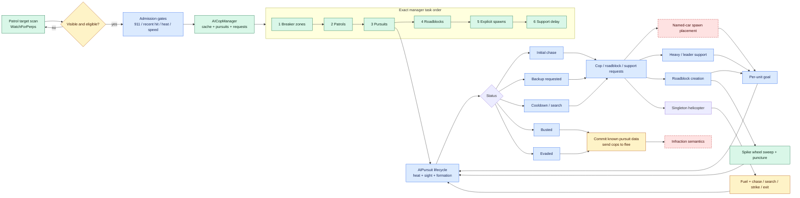

# Need for Speed: Most Wanted PC 1.3 cops and pursuit reverse-engineering report

> Analysis date: 2026-09-11  
> Target: owner-operated PC 1.3 executable running in CrossOver  
> Report flavor: `null` — ordinary PE reverse engineering, no malware/APT/vulnerability overlay  
> Evidence model: Evidence → Finding → Path

> **Completion boundary:** the PC executable has been identified exactly and a
> broad, address-bearing pursuit contract has been recovered. The complete cops
> and pursuit system is **not yet retail-equivalent**: task timing, normal spawn
> placement, infractions, several hooks, and pursuit-specific runtime behavior
> remain unresolved. No Unity police runtime code was changed during this work.

## Executive summary

The installed `speed.exe` is byte-for-byte identical to the PC 1.3 oracle in
the supplied decompilation corpus. That establishes that the corpus symbols,
preferred-image addresses, and objdiff match records describe the executable
actually run under CrossOver. A deterministic project-local generator mapped
354 pursuit-related functions (85,847 bytes) across 11 subsystems and classified
every function as exact, near, partial, or unmatched.

The strongest complete component is `SpikeStrip`: all six reported functions
and 956 bytes match exactly, including swept grounded-wheel intersection,
puncture, and strip cleanup. Manager dispatch order, generic cop/helicopter
spawn endpoints, per-unit goal transitions, two ground tactics, helicopter fuel
handling, and cop impact filtering also have exact anchors. The central
`AIPursuit::OnTask` is a large 95.30769% near match, giving a high-confidence
state/heat/bust/cooldown/request contract but not instruction identity.

A bounded CrossOver run proved startup, preferred-base mapping, and D3DMetal
initialization. It also showed native `DINPUT8.dll` and a widescreen ASI being
injected. The available automation surface could not drive or inspect the game
window, so this run did not execute or validate a pursuit scenario. The safe
next implementation step is the staged, test-first contract in
[Tools/Pursuit/PORT_CONTRACT.md](Tools/Pursuit/PORT_CONTRACT.md), not replacing
the current Unity police system wholesale.

## Scope and authorization

The case is an offline, owner-operated analysis of the locally installed PC
executable. In-scope work was PE triage, comparison with the verified local
decompilation corpus, bounded local CrossOver observation, and synthesis of a
port contract. Executable patching, third-party network access, unrestricted
instrumentation, denial of service, and external targets were out of scope.

The complete scope contract is in
[scope.md](</Users/tihan-nico/Documents/Codex/2026-09-11/se/reverse-skill/work/nfsmw-pc13-pursuit/scope.md>).
Authorization was recorded as `granted`, basis `own_system`, network mode
`offline`, and `ready_for_act=true` before analysis.

## Target identity and triage

| Property | Observed value | Evidence |
|---|---|---|
| File | `speed.exe` | E-001 |
| Format | PE32 GUI, Intel 80386 | E-001 |
| Size | 6,029,312 bytes | E-001 |
| MD5 | `c0516b485065fabdd69579816b5df763` | E-001 |
| SHA-256 | `80774c2e5d619b4f120b48d4462896fd504c263399d203a238769cffde1d253c` | E-001, E-004 |
| Image base | `0x00400000` | E-001 |
| Entry point | RVA `0x003c4040`, VA `0x007c4040` | E-001 |
| Corpus relationship | byte-identical (`cmp` exit 0) | E-004 |
| Runtime mapping | `0x400000-0xa79000` | E-012 |

The import directory is readable: 14 DLLs and 300 named/ordinal symbols.
Relevant dependencies include `KERNEL32`, `USER32`, `DINPUT8`, `d3d9`,
`d3dx9_26`, `GDI32`, `DSOUND`, `WINMM`, `ADVAPI32`, `SHFOLDER`, `SHELL32`,
`WS2_32`, `NETAPI32`, and `TAPI32`. The image has conventional sections, no
overlay, whole-file entropy 6.433668, `.text` entropy 6.513523, and no matched
common packer marker. This is triage evidence, not proof that no protection or
anti-debug behavior exists. Pursuit identifiers such as `AIPursuit`,
`AICopManager`, `AIRoadBlock`, `AIVehicleCopCar`, `SpikeStrip`,
`PursuitBegins`, and `PursuitEnds` are present in the image.

## Method

The analysis followed the PC decompilation repository's object-matching method
and kept each claim attached to an executable address and recovery class:

1. Hash and identify the installed PC 1.3 `speed.exe`.
2. Hash and byte-compare it with `orig/SPEED_EXE_1_3/speed.exe`.
3. Consume the configured PC 1.3 `report.json`, `symbols.json`, and
   `splits.json` produced by the repository's `ninja`/objdiff workflow.
4. Select the cops/pursuit classes, join mangled report symbols to absolute
   preferred-image virtual addresses, and hash every selected source file.
5. Read the current source around the high-value functions and bound semantic
   claims by each function's match class.
6. Launch the verified executable through its existing CrossOver bottle for a
   bounded startup observation.
7. Record unmatched functions, unmapped methods, mutable build inputs, injected
   runtime modules, and unavailable gameplay observation as explicit gaps.

The corpus was treated as read-only because it was an active dirty research
worktree. At evidence capture, its observed commit was
`ae37941e14a9f01acd715758861b1e68f353694d`; unrelated physics edits were
excluded from pursuit evidence. Because `build/.../report.json` is a mutable
generated artifact, the checked
[pursuit-evidence.json](Tools/Pursuit/pursuit-evidence.json) is the frozen
snapshot for this report.

### Recovery classification

| Class | Criterion | Count | Claim boundary |
|---|---:|---:|---|
| Exact | 100% objdiff match | 152 | Reported function machine code matches the oracle. |
| Near | at least 95%, below 100% | 120 | High-confidence behavior; inspect differences before identity claims. |
| Partial | above 0%, below 95% | 72 | Candidate structure/constants only. |
| Unmatched | 0% | 10 | Fidelity hole; no inferred substitute. |

The percentage is objdiff's fuzzy function match, not a statistical
probability. The ledger's `va_start` is an absolute preferred-image address from
`symbols.json`; `report_unit_offset` is not an executable address.

## Static analysis

### Coverage by subsystem

| Subsystem | Functions | Bytes | Weighted match | Exact / near / partial / unmatched |
|---|---:|---:|---:|---:|
| Cop manager | 55 | 21,031 | 84.677014% | 19 / 17 / 18 / 1 |
| Pursuit lifecycle and formations | 151 | 31,921 | 90.187499% | 48 / 82 / 19 / 2 |
| Roadblock classes with report mappings | 4 | 555 | 98.476404% | 2 / 2 / 0 / 0 |
| Spawn admission | 8 | 2,383 | 35.173794% | 1 / 0 / 6 / 1 |
| Ground units | 54 | 11,708 | 82.717325% | 40 / 6 / 7 / 1 |
| Unit tactics | 17 | 5,751 | 79.670145% | 7 / 5 / 5 / 0 |
| Helicopter | 38 | 9,166 | 84.640728% | 15 / 8 / 14 / 1 |
| Vehicle damage | 12 | 1,545 | 98.447620% | 11 / 0 / 1 / 0 |
| Spike strips | 6 | 956 | 100.000000% | 6 / 0 / 0 / 0 |
| Infractions | 3 | 263 | 0.000000% | 0 / 0 / 0 / 3 |
| Scheduler dependency | 6 | 568 | 79.529877% | 3 / 0 / 2 / 1 |

The roadblock row is intentionally narrow: it covers only functions that the
current report maps to `AIRoadBlock`/`AIActionStaticRoadBlock`. It does not
promote the large setup tables or unmapped distance/update methods.

### High-value binary anchors

| Function | VA | Bytes | Match | Class |
|---|---:|---:|---:|---|
| `AICopManager::OnTask` | `0x0043ef00` | 109 | 100% | exact |
| `AICopManager::SpawnPursuitCar` | `0x0042ea90` | 277 | 100% | exact |
| `AICopManager::SpawnPursuitHelicopter` | `0x004269a0` | 616 | 100% | exact |
| `AICopManager::SpawnPursuitIVehicle` | `0x00430e60` | 1,536 | 0% | unmatched |
| `AICopManager::CreateRoadBlock` | `0x0043dd30` | 2,619 | 95.77343% | near |
| `AICopManager::UpdatePursuits` | `0x0043e8d0` | 1,583 | 90.47337% | partial |
| `AIPursuit::OnTask` | `0x00443ba0` | 4,415 | 95.30769% | near |
| `AIPursuit::UpdateFormation` | `0x00443300` | 2,207 | 87.33038% | partial |
| `AIPursuit::CopRequest` | `0x0042ba50` | 670 | 96.38318% | near |
| `AIPursuit::RequestRoadBlock` | `0x004194b0` | 318 | 85.048546% | partial |
| `AIPursuit::RequestGroundSupport` | `0x00419680` | 526 | 99.815285% | near |
| `AIVehicleCopCar::WatchForPerps` | `0x0042f570` | 184 | 100% | exact |
| `AIVehicleCopCar::CheckForPursuit` | `0x00429ef0` | 436 | 96.60564% | near |
| `AIVehiclePursuit::Update` | `0x0042ac90` | 184 | 100% | exact |
| `SpikeStrip::OnCollide` | `0x006a4c80` | 311 | 100% | exact |
| `SpikeStrip::OnTaskSimulate` | `0x006a4dc0` | 366 | 100% | exact |
| `AIVehicleHelicopter::UpdateFuel` | `0x00423510` | 112 | 100% | exact |
| `AIActionHeliPursuit::Update` | `0x004277e0` | 271 | 81.7875% | partial |
| `SimTask::Run` | `0x006ecd90` | 202 | 92.242424% | partial / source marked unsolved |

### Lifecycle and escalation contract

The per-target state values are `InitialChase=0`, `BackupRequested=1`,
`Cooldown=2`, `Busted=3`, and `Evaded=4`. `AIPursuit` snapshots full-engagement
cop count, backup threshold, and evade timeout. Outside cooldown it advances
heat by `dT / TimePerHeatLevel`; heat bounds come from race/career context and
the final-epic branch allows heat 6.

Each pursuing unit contributes a last-seen age. Sight remains recent below 7
source-time units. After loss of sight, a 2.5-unit meter transition precedes
cooldown. Hidden zones add `dT * HiddenZoneTimeMultiplier`, and evade progress
is `(timeSinceSeen + hiddenZoneCredit) / evadetimeout`. Reacquisition decays the
displayed evade level by a `0.93` multiplier per lifecycle update before
leaving cooldown.

Bust charge requires target speed below the active `BustSpeed` and a nearest
pursuing cop within 15 horizontal world units. It charges by `dT * 0.25`,
decays by `dT * 0.5`, and reaches terminal state after the accumulated value
exceeds 5. Those are source-delta units, not confirmed seconds: `SimTask::Run`
is unsolved and the two constructed task rates (0.25 variable simulation and
1.0 variable bust task) have not been runtime-calibrated.

Formation IDs are PIT 1, box-in 2, rolling-block 3, follow 4, helicopter
pursuit 5, herd 6, and stagger-follow 7. Formation selection alternates
stagger-follow opportunities with weighted choices. Slot geometry and selection
details remain partial-confidence.

Cop requests subtract the current contingent from desired type records and
weighted-select a needed type while respecting helicopter delay. Roadblock
requests are delayed, reset a candidate timer to `[8,12)` source units, return
the previous pending state before selecting the next request, and attenuate
search probability by distance. Ground support is visible-only, checked on a
10-source-unit cadence after minimum delay, and prioritizes leader support with
Cross-specific behavior gated by availability.

### Manager, roadblocks, and units

The exact manager task order is breaker zones → patrols → pursuits → roadblocks
→ explicit spawns → support-delay decrement. The manager owns caches, active
pursuits, roadblocks, request queues, support state, and teardown. The generic
cop-car and singleton-helicopter spawn endpoints are exact, but normal named-car
placement is unmatched and `AISpawnManager` is only 35.173794% weighted.

Patrols require per-unit visibility. A fresh pursuit is suppressed only when
there is no 911 call, no traffic hit in the preceding source-time unit, heat is
at most 3, and speed is below 65 mph. Unit goal transitions for patrol,
pursuit, static roadblock, flee/helicopter exit, and support are exact. Ground
LOS geometry is partial and must remain replaceable.

Roadblock creation selects a valid non-decision traffic segment of at least 40
world units around 250 units ahead. Width index maps to minimum cop count
`{2,2,3,3,4,4,5}`. Candidate behavior selects a fitting predefined layout,
clamps lateral scale to `1..1.14`, caps layouts at six elements, and suppresses
spikes in cooldown. The source has 15 regular plus sentinel and 9 spike-capable
plus sentinel layouts. Manager roadblock creation is near-matched, while the
direct roadblock distance method and static update lack report mappings.

### Spike, helicopter, tactics, damage, and statistics

The exact spike simulation iterates grounded and previously unpunctured wheels,
sweeps a box with half-dimensions `(0.15, radius, radius)` by `velocity * dT`,
punctures an intersecting wheel, and eventually replaces the strip collision
map with a trigger before destroying the strip's owning simable. A near-match
handler can promote up to three nearest roadblock cops after a spike hit.

Helicopter fuel exhaustion and transition to exit are exact. Helicopter LOS,
straight/search/skid-hit pursuit, and exit geometry are partial. Exact tactics
include head-on ram at 100 kph and the jackknife setup/handbrake turn. Exact cop
impact filtering ignores movable scenery below mass 2000 for ordinary damage.
The helicopter impact hook, roadblock-cop collision modifier, and stop-short
update lack direct mappings.

The near-matched cost-to-state formula weights destroyed cops 5000,
helicopters 2000, roadblocks 500, damaged cops 250, traffic hits 500, ground
spike strips 250, helicopter strips 225, deployed cop cars 250, support
vehicles 450, then adds property damage. Terminal manager flow distinguishes
busted and evaded results and releases involved units, but infraction manager
semantics are entirely unmatched.

## Recovered callflow

Green nodes are exact anchors, blue nodes are near-matched contracts, amber
nodes are partial, and dashed red nodes are unresolved.



Editable source:
[nfsmw-pursuit-callflow.mmd](Tools/Pursuit/nfsmw-pursuit-callflow.mmd).
The repository render helper was run, but no SVG is claimed or linked because
the optional Mermaid CLI renderer is not installed. The report embeds the
editable source directly.

## Dynamic analysis

CrossOver 26.3.0.39832 created the verified `speed.exe`, mapped it at
`0x400000-0xa79000`, and selected D3DMetal. The host process stayed live for 15
one-second polls and exited after bounded SIGTERM shutdown.

The runtime was not pristine. It loaded a native game-directory `DINPUT8.dll`
(SHA-256 `7675b24a2e408349c8a59b87e3ae8724ad8a89eff21c96a9c109650a3c1316e0`)
and `NFSMostWanted.WidescreenFix.asi`
(SHA-256 `af263e997168b7b6663ec7fc72e54ccfda0e85b1d9f507fa69ce3504d145a0b4`).
The available automation surface could not control or inspect the native game
window. No evidence showed `AICopManager`, `AIPursuit`, a roadblock, a spike
strip, support, or a helicopter action executing. Dynamic pursuit validation
is therefore unavailable, not failed.

## Evidence chain

The immutable case Evidence records are stored under
[evidence](</Users/tihan-nico/Documents/Codex/2026-09-11/se/reverse-skill/work/nfsmw-pc13-pursuit/evidence/>).

| ID | Source / artifact | Reproduction | Hash or fixity |
|---|---|---|---|
| E-001 | PE triage summary | `file`, `shasum`, `md5`, `pe_triage.py` | `54a054b5…6717` |
| E-002 | imports and packing triage | `objdump -p`, strings scan | same triage artifact |
| E-003 | pursuit strings | `strings -a -t x … | rg` | `5e1f2c34…4d38e` |
| E-004 | corpus/oracle equivalence | `shasum`, `cmp`, Git snapshot | `92d3a593…24b0` |
| E-005 | superseded initial ledger record | superseded by E-006 | n/a |
| E-006 | versioned address-bearing ledger | project generator | `52309bcb…27ff` |
| E-007 | lifecycle/source correlation | ledger query + focused source anchors | ledger fixity |
| E-008 | manager/source correlation | ledger query + focused source anchors | ledger fixity |
| E-009 | patrol/roadblock/spike correlation | ledger query + focused source anchors | ledger fixity |
| E-010 | helicopter/tactic/damage correlation | ledger query + focused source anchors | ledger fixity |
| E-011 | full-equivalence gaps | `jq '{subsystems,key_function_gaps}'` | ledger fixity |
| E-012 | bounded CrossOver startup | recorded CrossOver launch | `3baa7f2d…cefa` |
| E-013 | injected modules and no-gameplay boundary | targeted runtime-log scan | same runtime artifact |
| E-014 | normalized ledger reproducibility | regenerate and compare pursuit semantic projection | checked ledger `52309bcb…27ff` |

### Findings

| ID | Severity | Status | Confidence | Location | Evidence IDs | Impact / required action |
|---|---|---|---|---|---|---|
| F-001 | n/a_re | validated | high | image base `0x00400000`, oracle SHA-256 | E-001, E-004, E-012 | Installed/corpus address identity is established. |
| F-002 | n/a_re | candidate | high | `AIPursuit::OnTask` `0x00443ba0` and request methods | E-006, E-007, E-011, E-013 | Use as a source-time contract; do not claim runtime-exact timing. |
| F-003 | n/a_re | candidate | high | `AICopManager::OnTask` `0x0043ef00` and children | E-006, E-008, E-011 | Preserve exact ownership/order; isolate unmatched placement. |
| F-004 | n/a_re | candidate | high | patrol and unit goal functions | E-006, E-009, E-013 | Admission/goals are usable; LOS geometry stays provisional. |
| F-005 | n/a_re | validated | high | `SpikeStrip` `0x006a4c80` / `0x006a4dc0` | E-004, E-006, E-009 | Swept wheel puncture and cleanup are binary-backed. |
| F-006 | n/a_re | candidate | medium | helicopter LOS/pursuit/exit | E-006, E-010, E-013 | Fuel is exact; flight and strike behavior require oracle capture. |
| F-007 | n/a_re | validated | high | cross-subsystem gap boundary | E-006, E-011, E-013 | Full retail-equivalence claim is presently unsupported. |
| F-008 | n/a_re | validated | high | CrossOver startup trace | E-001, E-012, E-013 | Startup is proven; pursuit gameplay was not observed. |

Canonical structured Finding records, including category, reproduction steps,
and remediation, are in
[findings.md](</Users/tihan-nico/Documents/Codex/2026-09-11/se/reverse-skill/work/nfsmw-pc13-pursuit/report/findings.md>).

### Path P-001 — binary-to-behavior recovery

- `path_type`: `solve`
- start: installed owner-operated PC executable
- goal: confidence-bounded cops and pursuit behavior contract
- steps:
  1. PE identity/import/string triage (E-001, E-002, E-003 → F-001).
  2. Byte-identical corpus oracle proof (E-004 → F-001).
  3. Report/symbol/source join into the frozen ledger and normalized
     reproduction after unrelated report drift (E-006/E-014 → F-002/F-003).
  4. Subsystem source correlation (E-007–E-010 → F-002–F-006).
  5. Unmatched and unsolved inventory (E-011 → F-007).
  6. Bounded startup and runtime limitation capture (E-012/E-013 → F-008/F-007).
- residual risks: mutable report inputs, no pursuit gameplay trace, and
  partial/unmatched functions.

### Path P-002 — ground pursuit callflow

- `path_type`: `callflow`
- start: patrol or explicit dispatch examines a target
- goal: busted/evaded terminal result and unit release
- steps: visible patrol admission (E-009/F-004) → manager pursuit ownership
  (E-008/F-003) → lifecycle/heat/bust/cooldown (E-007/F-002) → request queues
  and support/roadblocks (E-007/E-008) → per-unit goals/tactics
  (E-009/E-010) → exact spike consequence (E-009/F-005) → partial terminal
  commit/release (E-008/E-011/F-007).
- residual risks: scheduler, normal spawn placement, infractions, roadblock
  hooks, LOS, formation details, and teardown edge cases.

The helicopter callflow is separately recorded as P-003 in
[paths.md](</Users/tihan-nico/Documents/Codex/2026-09-11/se/reverse-skill/work/nfsmw-pc13-pursuit/report/paths.md>).

## Reproduction

Generate a fresh ledger from the current corpus state without overwriting the
checked snapshot:

```bash
PURS_DECOMP='/Users/tihan-nico/.codex/worktrees/1a8f/NFS MW Remaster/Library/PCDecompilation/nfsmw-pc-match'
PURS_ORACLE='/Users/tihan-nico/Library/Application Support/CrossOver/Bottles/NFS MW/drive_c/Program Files (x86)/NFS Most Wanted/speed.exe'
PURS_TMP="$(mktemp -d)"

python3 Tools/Pursuit/extract_pursuit_evidence.py "$PURS_DECOMP" \
  --oracle "$PURS_ORACLE" \
  --output "$PURS_TMP/pursuit-evidence.json"

jq -r '.key_functions[] |
  [.demangled_name,.va_start,.size,.fuzzy_match_percent,.recovery_class] |
  @tsv' "$PURS_TMP/pursuit-evidence.json"
```

Verify the checked artifact:

```bash
shasum -a 256 Tools/Pursuit/pursuit-evidence.json
```

Expected checked ledger SHA-256:
`52309bcbc7e87b4229076885b604db3225e010268a83c43144a0c7375b1027ff`.
A fresh ledger may legitimately differ when the active decompilation report
moves; review its input hashes and pursuit records instead of assuming drift is
either harmless or a regression.

## Unity integration decision

The existing Unity police system is explicitly documented as provisional and
NFS-2015-influenced. Its states (`Patrol → Observed → TrafficStop → Pursuit →
Cooldown → OutcomePending`), fine-derived engagement, short contact grace,
constant bust hold, authored hazards, and empty spike consequence do not match
the recovered PC 1.3 topology.

Replacing that system during reverse engineering would mix evidence recovery
with a high-risk gameplay/persistence migration. The recommended boundary is:

1. retain the current durable settlement/persistence contract;
2. build a pure, source-time Most Wanted pursuit aggregate beside it;
3. implement exact manager order, unit goal transitions, and spike behavior
   first;
4. add near-match lifecycle/admission/request behavior under deterministic
   tests;
5. keep spawn, LOS, formation, helicopter flight, and infractions behind
   explicit adapters until measured;
6. map only terminal `Busted`/`Evaded` outcomes into the durable product layer,
   exactly once.

The detailed interfaces, constants, and test gates are in
[PORT_CONTRACT.md](Tools/Pursuit/PORT_CONTRACT.md).

## Unresolved gates

The following block a “full retail-equivalent cops and pursuit” claim:

- `SimTask::Run` is partial and source-marked unsolved, so source task rates
  cannot yet be translated into wall-clock time.
- `SpawnPursuitIVehicle` and `AISpawnManager::GetSpawnLocation` are unmatched;
  spawn admission/placement has only 35.173794% weighted recovery.
- All three reported `GInfractionManager` functions are unmatched and the
  current `.cpp` is empty.
- `AIRoadBlock::GetMinDistanceToTarget`,
  `AIActionStaticRoadBlock::Update`, `AIActionStopShort::Update`,
  `DamageHeli::OnImpact`, and `RBCop::ModifyCollision` have no direct current
  report mapping.
- Formation assignment, cop/heli LOS, helicopter flight, roadblock update, and
  pursuit teardown contain material partial-match functions.
- The only dynamic run was mod-injected startup; no controlled pursuit,
  roadblock, spike, support, or helicopter scenario was observed.

## Timeline summary

| Phase | Result | Evidence |
|---|---|---|
| Scope | Offline owner-operated executable authorized; network and patching excluded. | scope contract |
| Triage | PE identity, imports, pursuit strings, and corpus equivalence established. | E-001–E-004 |
| Static | 354-function ledger and confidence-bounded subsystem behavior recovered. | E-005–E-011 |
| Dynamic | Startup verified; injected modules and unavailable pursuit observation recorded. | E-012–E-013 |
| Synthesis | Findings, callflow paths, port contract, and editable diagram produced; normalized ledger semantics reverified. | E-014, F-001–F-008, P-001–P-003 |

The append-only case timeline is in
[timeline.md](</Users/tihan-nico/Documents/Codex/2026-09-11/se/reverse-skill/work/nfsmw-pc13-pursuit/timeline.md>).

## Artifacts

| Artifact | Purpose |
|---|---|
| [Tools/Pursuit/README.md](Tools/Pursuit/README.md) | Ledger usage and confidence semantics. |
| [Tools/Pursuit/extract_pursuit_evidence.py](Tools/Pursuit/extract_pursuit_evidence.py) | Deterministic extractor. |
| [Tools/Pursuit/pursuit-evidence.json](Tools/Pursuit/pursuit-evidence.json) | Frozen address/source/hash ledger. |
| [Tools/Pursuit/PORT_CONTRACT.md](Tools/Pursuit/PORT_CONTRACT.md) | Port architecture, constants, confidence tiers, and verification gates. |
| [Tools/Pursuit/nfsmw-pursuit-callflow.mmd](Tools/Pursuit/nfsmw-pursuit-callflow.mmd) | Editable flowchart source. |
| [case report directory](</Users/tihan-nico/Documents/Codex/2026-09-11/se/reverse-skill/work/nfsmw-pc13-pursuit/report/>) | Canonical structured Findings, Paths, and strict review output. |

No original executable or decompilation source is copied into this project.
