# Need for Speed: Most Wanted PC 1.3 schema-3 gameplay capture reverse-engineering report

> Analysis date: 2026-09-12  
> Target: owner-operated PC 1.3 executable running in CrossOver  
> Capture: `capture-20260912-205005-220.bin`  
> Report flavor: `null` — ordinary PE reverse engineering  
> Evidence model: Evidence → Finding → Path

> **Completion boundary:** this capture closes the earlier “schema-3 tracer has
> not been run” gap for the 12 enabled survey hooks. It proves 100,000 sampled
> function entries from this gameplay scenario, including manager scheduling,
> goal selection, pursuit-spawn attempts, traffic, roadblocks, and helicopter
> fuel behavior. It does **not** prove return values, successful spawn counts,
> call durations, exact state-transition times, full retail equivalence, or
> PS5 controller/menu input behavior. The trace reached its configured record
> limit, so behavior after its terminal record is outside the capture.

## Executive summary

The 102,441,984-byte schema-3 capture is closed, contiguous, and lossless. Its
embedded target SHA-256 and 48-hook catalogue match the exact installed PC 1.3
executable analyzed by the local decompilation corpus. The decoder found 100,000
entry records, 24 checkpoints, one terminal record, no sequence gaps or
duplicates, no truncated tail, and no reported queue, read, or write loss.

The run exercised a broad AI slice: 62,633 goal-selection entries, at least
2,046,849 vehicle simulation calls by the final sampled entry, 12,167 traffic
spawn entries, 3,385 cop-manager task samples, 1,930 pursuit task samples, 284
cop-spawn routine entries, 36 helicopter update samples, and five racecar update
samples. All gameplay entries were recorded on thread 224.

Retail instructions independently locate the relevant scheduler fields. Every
one of the 5,747 captured cop-manager, traffic-manager, and pursuit task samples
agrees with those fields, including distinct pursuit simulate and busted-timer
handles. That cross-check turns otherwise anonymous raw bytes into bounded,
high-confidence runtime state.

The 284 `SpawnPursuitIVehicle` observations all target one pursuit pointer and
contain 19 vehicle pointer values. These are **entry attempts**, not 284 proven
successful spawns: the routine has several false-return branches and schema 3
does not record returns.

The strongest new behavior result is helicopter fuel. Exact retail code
subtracts `dT` from object offset `+0x7D8`, clamps it at zero, and evaluates the
`AIGoalHeliExit` path. Two independently sampled object series are strictly
non-increasing; one runs from `60.0` to `0.0`, overlapping the observed
`AIGoalHeliExit` chooser window.

This was an AI survey profile. It contains no DirectInput/controller or frontend
menu hooks, so it cannot explain why PS5 controller actions failed to navigate
the menu. That requires a separate input-focused capture.

## Scope and authorization

This is an offline analysis of the user's own installed executable, its local
runtime capture, and the byte-identical local source-recovery corpus. The scope
contract is [scope.md](</Users/tihan-nico/Documents/Codex/2026-09-11/se/reverse-skill/work/nfsmw-pc13-runtime-capture-20260912/scope.md>); it records
`auth.status=granted`, `basis=own_system`, `network_profile.mode=offline`, and
`ready_for_act=true`.

In scope were capture certification, PE/import triage, retail instruction
inspection, source/binary correlation, sampled-object decoding, a reproducible
census, and documentation. Network interaction, unrelated executables,
unrestricted instrumentation, and destructive changes were out of scope. The
installed executable and capture were read only.

This report supplements
[the full AI-system report](2026-09-11_reverse-engineering-nfsmw-ai-system-report.md)
and [the cops/pursuit report](2026-09-11_reverse-engineering-nfsmw-pursuit-report.md).
It supersedes only their runtime-readiness statements where this capture now
provides evidence.

## Target and capture identity

| Property | Observed value | Evidence |
|---|---|---|
| Executable | `SPEED.EXE`, PE32 GUI, Intel 80386 | E-001 |
| Executable size | 6,029,312 bytes | E-001, E-003 |
| Executable SHA-256 | `80774c2e5d619b4f120b48d4462896fd504c263399d203a238769cffde1d253c` | E-001, E-003 |
| Corpus relationship | installed and corpus executables byte-identical | E-003 |
| Image base / image size | `0x00400000` / 6,786,638 bytes | E-001 |
| Capture SHA-256 | `951dd4be8c1fdfc1b1726207fcafeef21ff40481f3840acc0e5ccd95fe11dd46` | E-002 |
| Capture size | 102,441,984 bytes | E-002 |
| Capture ID | `3b4641467dd7270d42f3e20009bfa363` | E-002 |
| Catalogue SHA-256 | `dffdc6c6a3ad9fd18e8ce72a95afdd258e4b839cbe1dba4b068438dbc7539c51` | E-002 |
| Trace start | 2026-09-12 20:50:05.766 UTC / 22:50:05.766 SAST | E-002 |
| First / terminal event | 29.155616 / 1415.293030 seconds after trace start | E-002, E-004 |
| Entry-event span | 1,386.137414 seconds | E-002 |
| Terminal reason | configured record limit | E-002 |

## Method

1. Certify authorization and keep the analysis offline.
2. Hash and identify the installed image; validate all 48 configured hook
   anchors against its prologues.
3. Strictly decode the binary capture and reject it if target/catalogue identity,
   sequence continuity, counters, or terminal state fail.
4. Disassemble each interpretation anchor in the installed retail image.
5. Correlate only exact/near recovered source functions, retaining the current
   recovery class for each claim.
6. Decode the capture to JSONL and stream it through the project-local analyzer.
7. Name raw object offsets only where the retail instructions independently
   establish the field access.
8. Keep sampling, entry-only, pointer-lifetime, and whole-unit fidelity limits
   attached to every conclusion.

## Static analysis

### PE and imports

The import directory is readable and covers 14 DLLs: `ADVAPI32`, `d3d9`,
`d3dx9_26`, `DINPUT8`, `DSOUND`, `GDI32`, `KERNEL32`, `NETAPI32`, `SHELL32`,
`SHFOLDER`, `TAPI32`, `USER32`, `WINMM`, and `WS2_32`. Relevant imports include
`Direct3DCreate9`, `DirectInput8Create`, `LoadLibraryA`, `GetProcAddress`,
`QueryPerformanceCounter`, `ReadFile`, and `WriteFile`.

Section entropy is conventional for this image (`.text` 6.5135, `.rdata`
5.3634, `.data` 3.9560, `.rsrc` 3.6328). Combined with the rich IAT, this gives
no ordinary sparse-IAT/high-entropy packer indication. It is triage evidence,
not proof that no protection or anti-analysis mechanism exists.

### Retail function anchors

| Function | VA range | Recovery | Claim used here |
|---|---:|---:|---|
| `AIGoal::ChooseAction` | `0x0042B070–0x0042B122` | exact 100% | chooser entry and goal-object vtable snapshot |
| `AICopManager::OnTask` | `0x0043EF00–0x0043EF6D` | exact 100% | normalized task field `+0x80` |
| `AITrafficManager::OnTask` | `0x00439CD0–0x00439CF0` | exact 100% | normalized task field `+0x5C` |
| `AIPursuit::OnTask` | `0x00443BA0–0x00444CDF` | near 97.876434% | direct retail reads at normalized `+0x54` and `+0x58` only |
| `AITrafficManager::SpawnTraffic` | `0x00439A10–0x00439BA6` | near 99.333336% | routine identity; entries are not successes |
| `AICopManager::SpawnPursuitIVehicle` | `0x00430E60–0x00431460` | partial 83.846695% | routine identity/arguments; entries are not successes |
| `AIVehicleHelicopter::Update` | `0x0042ADB0–0x0042AED0` | partial 89.89109% | hook identity only |
| `AIVehicleHelicopter::UpdateFuel` | `0x00423510–0x00423580` | exact 100% | fuel at `+0x7D8`, subtract/clamp/exit-goal path |

The exact `UpdateFuel` instructions load `+0x7D8`, subtract `dT`, write the
result back, compare with zero, and clamp negative values to zero before the
goal check. The manager entry instructions similarly expose their task fields
without relying on source-layout comments.

### Goal vtable correlation

`AIGoalTraffic` is directly named in the retail symbol map and its constructor
is an exact match. The other names are high-confidence correlations: each
retail constructor stores the listed vtable, has the distinctive sequence of
`AddAction` calls present in the recovered source, and appears in the same
source/binary compilation order.

| Goal family | Vtable | Constructor VA | Basis |
|---|---:|---:|---|
| `AIGoalTraffic` | `0x00892BF0` | `0x0043B670` | named vtable + exact constructor |
| `AIGoalPatrol` | `0x00892C14` | `0x0043B730` | constructor/action correlation |
| `AIGoalPursuit` | `0x00892B30` | `0x0043B800` | constructor/action correlation |
| `AIGoalStopShort` | `0x00892C88` | `0x0043B9B0` | constructor/action correlation |
| `AIGoalHeadOnRam` | `0x00892CD8` | `0x0043BD10` | unique `-3.0` position-offset setup + actions |
| `AIGoalStaticRoadBlock` | `0x00892B40` | `0x0043BE50` | constructor/action correlation |
| `AIGoalFleePursuit` | `0x00892D00` | `0x0043BED0` | constructor/action correlation |
| `AIGoalHeliPursuit` | `0x00892D10` | `0x0043BFC0` | constructor/action correlation |
| `AIGoalHeliExit` | `0x00892D20` | `0x0043C090` | constructor/action correlation |
| `AIGoalRacer` | `0x00892D30` | `0x0043C160` | constructor/action correlation |

### Whole-unit boundary

The current complete zAI ledger contains 3,696 functions / 250,735 code bytes:
556 exact, 205 near, 128 partial, and 2,807 unmatched. This capture adds runtime
reachability and field observations; it does not turn unmatched functions into
recovered implementations or establish full retail equivalence.

## Dynamic analysis

### Capture certification

| Check | Result |
|---|---|
| Activation | `closed` |
| Records | 100,000 entry + 24 checkpoint + 1 terminal |
| Sequence | `1..100025`, contiguous, no duplicates or gaps |
| File tail | 0 truncated bytes |
| Queue losses | 0; high-water 3 of 2,048 |
| Read faults / budget overruns | 0 / 0 |
| Write failures | 0 |
| Terminal | last record, reason `limit` |
| Target/catalogue | both match local expected values |
| Decoder verdict | `complete_closed_capture=true`, `lossless_admitted_capture=true` |

### Hook census

The tracer applies per-hook sampling divisors. `Entry samples` is the number
stored in this capture; `highest call index` is a lower bound on calls reached by
the last stored sample, not a session-final total after the trace stopped.

| Hook | Divisor | Entry samples | Highest call index | First–last seconds after trace start |
|---|---:|---:|---:|---:|
| `AIGoal::ChooseAction` | 1 | 62,633 | 62,633 | 29.156–1415.293 |
| `AIVehicle::OnTaskSimulate` | 128 | 15,992 | 2,046,849 | 29.429–1415.252 |
| `AITrafficManager::SpawnTraffic` | 1 | 12,167 | 12,167 | 29.610–1387.091 |
| `AICopManager::OnTask` | 16 | 3,385 | 54,145 | 29.444–1415.208 |
| `AIPursuit::OnTask` | 16 | 1,930 | 30,865 | 122.804–1414.847 |
| `AITarget::TrackAll` | 64 | 1,693 | 108,289 | 29.429–1415.203 |
| `AIVehicle::Update` | 128 | 1,011 | 129,281 | 29.442–1414.220 |
| `AITrafficManager::OnTask` | 32 | 432 | 13,793 | 29.610–1415.067 |
| `Gps::Update` | 64 | 432 | 27,585 | 29.532–1414.980 |
| `AICopManager::SpawnPursuitIVehicle` | 1 | 284 | 284 | 180.341–1349.287 |
| `AIVehicleHelicopter::Update` | 64 | 36 | 2,241 | 728.998–1320.509 |
| `AIVehicleRacecar::Update` | 128 | 5 | 513 | 980.636–1283.664 |

All 100,000 function entries above occurred on gameplay thread 224. Checkpoint
and terminal records were emitted on writer thread 312 and are excluded from
the hook census.

### Scheduler-field cross-check

| Entry hook | Captured argument | Retail-proven normalized field | Matching samples |
|---|---:|---:|---:|
| `AICopManager::OnTask` | 15 | `simulate_task +0x80 = 15` | 3,385 / 3,385 |
| `AITrafficManager::OnTask` | 16 | `task +0x5C = 16` | 432 / 432 |
| `AIPursuit::OnTask` | 169 | `simulate_task +0x54 = 169` | 386 / 386 |
| `AIPursuit::OnTask` | 170 | `busted_timer_task +0x58 = 170` | 1,544 / 1,544 |

This establishes that the trace normalized each Activity subobject back to the
intended owning object and that the two pursuit scheduling branches were both
executed. It does not establish the result of each `OnTask` call.

### Goal chooser census

These are calls entering `AIGoal::ChooseAction`, grouped by the goal object's
vtable. They are not frame durations or a count of distinct goal lifetimes.

| Goal family | Entry samples | Unique object addresses | First–last seconds |
|---|---:|---:|---:|
| `AIGoalPursuit` | 28,935 | 66 | 122.779–1411.854 |
| `AIGoalTraffic` | 16,226 | 275 | 34.776–1415.066 |
| `AIGoalStaticRoadBlock` | 8,412 | 44 | 520.789–1386.980 |
| `AIGoalFleePursuit` | 2,706 | 28 | 301.147–1415.293 |
| `AIGoalHeliPursuit` | 2,079 | 2 | 728.939–1326.284 |
| `AIGoalHeadOnRam` | 1,886 | 14 | 588.054–1411.859 |
| `AIGoalStopShort` | 1,361 | 18 | 207.090–1415.289 |
| `AIGoalRacer` | 567 | 1 | 29.156–1285.317 |
| `AIGoalPatrol` | 265 | 1 | 103.164–122.775 |
| `AIGoalHeliExit` | 196 | 1 | 821.634–840.345 |

### Sampled vehicle classes

These are sampled `AIVehicle::OnTaskSimulate` entries. The vtables are named in
the retail symbol map, but address reuse means unique pointers are not guaranteed
unique lifetime instances.

| Vehicle class | Entry samples | Unique object addresses | First–last seconds |
|---|---:|---:|---:|
| `AIVehicleTraffic` | 9,789 | 65 | 33.695–1415.252 |
| `AIVehicleCopCar` | 4,434 | 53 | 102.710–1415.119 |
| `AIVehicleEmpty` | 755 | 10 | 273.655–1268.355 |
| `AIVehicleHuman` | 740 | 1 | 29.429–1287.086 |
| `AIVehicleHelicopter` | 274 | 2 | 720.673–1349.151 |

### Pursuit spawn attempts

`AICopManager::SpawnPursuitIVehicle` was entered 284 times between 180.341 and
1349.287 seconds. Every entry used pursuit pointer `0x021635F8`; the second
argument covered 19 vehicle pointer values. The most frequently supplied
vehicle pointer appeared in 96 entries.

The source contains several early `false` returns for unavailable navigation,
interfaces, target state, or vehicle reset. Because the capture is entry-only,
the defensible conclusion is “284 attempts entered,” not “284 cars spawned.”

### Helicopter fuel

| Object address | Samples | First fuel | Last fuel | Min–max | Monotonic check |
|---|---:|---:|---:|---:|---|
| `0x04B936E0` | 19 | 60.000000 | 0.000000 | 0.000000–60.000000 | 18/18 non-increasing |
| `0x04B85400` | 17 | 87.262253 | 34.597824 | 34.597824–87.262253 | 16/16 non-increasing |

The first object's samples begin at 728.998 seconds, reach `1.280294` at
819.864, then reach `0.0` at 825.858 and remain zero through 838.086. The
`AIGoalHeliExit` chooser window is 821.634–840.345 seconds. This timing agrees
with the exact fuel/exit code, but the 64-call sampling divisor prevents an
instruction-exact transition timestamp.

## Observed gameplay timeline

The arrows below encode first-observation order, not proven causality or direct
state transitions. Editable source:
[capture-20260912-ai-observation-timeline.mmd](Tools/AI/RuntimeTrace/capture-20260912-ai-observation-timeline.mmd).

```mermaid
flowchart LR
  trace_start["Trace start<br/>20:50:05.766 UTC"]
  baseline["29-35 s<br/>Racer, human vehicle, traffic"]
  patrol["103.164 s<br/>Patrol goal first observed"]
  pursuit["122.779 s<br/>Pursuit goal first observed"]
  spawn["180.341 s<br/>Cop-spawn entries begin"]
  tactics["207-588 s<br/>StopShort, Flee, RoadBlock, HeadOnRam"]
  helicopter["720-729 s<br/>Helicopter simulation and pursuit goal"]
  heli_exit["821.634-840.345 s<br/>HeliExit chooser observations<br/>fuel sample reaches 0 at 825.858 s"]
  late_race["980.636 s<br/>Racecar Update first sampled"]
  trace_end["1415.293 s<br/>Terminal: record limit"]
  boundary["First-observation ordering only<br/>not proven state transitions"]

  trace_start --> baseline
  baseline -. later first observation .-> patrol
  patrol -. later first observation .-> pursuit
  pursuit -. later first observation .-> spawn
  spawn -. later first observation .-> tactics
  tactics -. later first observation .-> helicopter
  helicopter -. sampled countdown .-> heli_exit
  heli_exit -. later first observation .-> late_race
  late_race --> trace_end
  boundary -. interpretation boundary .-> pursuit
```



## Evidence chain

| E-id | Source reference | Reproduction | Content hash |
|---|---|---|---|
| E-001 | installed `SPEED.EXE`; target validator | `file`, `shasum`, `validate_target.py` | n/a |
| E-002 | binary schema-3 capture | strict `decoder.py --format analysis` | n/a; capture hash retained in record |
| E-003 | retail disassembly, current zAI ledger, recovered source | focused `objdump` + `jq` | n/a |
| E-004 | schema-3 JSONL + `analyze_gameplay.py` | decoder → analyzer replay | n/a; derived artifact SHA-256 `04475a6e…999b95` |

Full Evidence records are in the formal
[case directory](</Users/tihan-nico/Documents/Codex/2026-09-11/se/reverse-skill/work/nfsmw-pc13-runtime-capture-20260912/evidence/>).

## Findings

| F-id | Finding | Severity | Evidence | Confidence | Location | Status |
|---|---|---|---|---|---|---|
| F-001 | Capture is lossless, closed, and bound to the exact PC 1.3 executable | `n/a_re` | E-001, E-002 | high | header, terminal, executable identity | validated |
| F-002 | All captured manager/pursuit task arguments agree with retail-proven object fields | `n/a_re` | E-003, E-004 | high | three `OnTask` entries | validated |
| F-003 | Run exercised traffic, pursuit, roadblock, helicopter, racer, and associated goal families | `n/a_re` | E-003, E-004 | high | chooser/simulation entries | validated |
| F-004 | One pursuit produced 284 observed spawn entry attempts over 19 vehicle pointer values | `n/a_re` | E-003, E-004 | high | `SpawnPursuitIVehicle` entry | validated |
| F-005 | Helicopter fuel is a countdown at `+0x7D8` that can drive the HeliExit path | `n/a_re` | E-003, E-004 | high | `UpdateFuel` + runtime samples | validated |

The complete finding statements and residual risks are in
[findings.md](</Users/tihan-nico/Documents/Codex/2026-09-11/se/reverse-skill/work/nfsmw-pc13-runtime-capture-20260912/findings.md>).

## Path

`P-001` is a validated callflow path:

1. Target/catalogue identity and capture integrity admit the trace (E-001,
   E-002; F-001).
2. Manager and pursuit schedulers receive arguments matching their retail
   object fields (E-003, E-004; F-002).
3. Goal selection and vehicle simulation expose traffic, racer, police,
   roadblock, and helicopter families (E-003, E-004; F-003).
4. The cop manager enters its pursuit-vehicle spawn routine 284 times; return
   success remains outside visibility (E-003, E-004; F-004).
5. Helicopter updates expose the exact fuel field reaching zero alongside the
   HeliExit chooser window (E-003, E-004; F-005).

The formal path record is
[paths.md](</Users/tihan-nico/Documents/Codex/2026-09-11/se/reverse-skill/work/nfsmw-pc13-runtime-capture-20260912/paths.md>).

## Analysis timeline

| Time (SAST) | Phase | Result |
|---|---|---|
| 23:34:11 | scope | owner-operated offline case authorized |
| 23:36:46 | triage | exact PE/import identity and lossless capture certified |
| 23:46:55 | static/dynamic correlation | task fields, goal/vehicle classes, spawn attempts, and fuel cross-checked |
| 23:49:19 | synthesis | capture-specific report and editable timeline prepared |

The append-only source is
[timeline.md](</Users/tihan-nico/Documents/Codex/2026-09-11/se/reverse-skill/work/nfsmw-pc13-runtime-capture-20260912/timeline.md>).

## Reproduction

```bash
CAPTURE='/Users/tihan-nico/Library/Application Support/CrossOver/Bottles/NFS MW/drive_c/Program Files (x86)/NFS Most Wanted/scripts/NFSMWAITrace/capture-20260912-205005-220.bin'
SPEED_EXE='/Users/tihan-nico/Library/Application Support/CrossOver/Bottles/NFS MW/drive_c/Program Files (x86)/NFS Most Wanted/SPEED.EXE'

shasum -a 256 "$SPEED_EXE" "$CAPTURE"
python3 Tools/AI/RuntimeTrace/validate_target.py --target "$SPEED_EXE"
python3 Tools/AI/RuntimeTrace/decoder.py "$CAPTURE" --format analysis --output /tmp/nfsmw-analysis.json
python3 Tools/AI/RuntimeTrace/decoder.py "$CAPTURE" --format jsonl --output /tmp/nfsmw-runtime.jsonl
python3 Tools/AI/RuntimeTrace/analyze_gameplay.py /tmp/nfsmw-runtime.jsonl \
  --expect-target-sha256 80774c2e5d619b4f120b48d4462896fd504c263399d203a238769cffde1d253c \
  --output /tmp/nfsmw-gameplay-analysis.json
```

Focused retail offset checks:

```bash
objdump -d --start-address=0x43ef00 --stop-address=0x43ef35 "$SPEED_EXE"
objdump -d --start-address=0x439cd0 --stop-address=0x439cf0 "$SPEED_EXE"
objdump -d --start-address=0x443ba0 --stop-address=0x443c10 "$SPEED_EXE"
objdump -d --start-address=0x423510 --stop-address=0x423560 "$SPEED_EXE"
```

## Remaining limits and next evidence

- Schema 3 records entries only. Add tightly scoped exit hooks before making
  spawn-success, Boolean-result, or duration claims.
- The survey profile samples several hot hooks. A record count is not an exact
  full-call count unless the divisor is one, and the trace ended at its record
  cap.
- Goal names other than `AIGoalTraffic` are high-confidence constructor/action
  correlations, not original named vtable symbols.
- Memory addresses identify observations, not durable object identities across
  allocator reuse.
- The run is one scenario. It does not establish behavior across every race,
  heat level, pursuit phase, or world state.
- The complete zAI object remains far from retail-equivalent: 2,807/3,696
  functions are still unmatched.
- Controller/menu failure is unresolved because this profile has no input
  hooks. A follow-up should trace DirectInput device enumeration/state, the
  frontend navigation action mapper, and return/status values while the user
  presses the DualSense controls in the menu and in gameplay.

For the next AI-specific capture, the highest-value narrow hooks are
`SpawnPursuitIVehicle` return, goal assignment, `UpdateFuel` entry/exit, and
helicopter unspawn. That would distinguish attempts from successes and bound
the zero-fuel → HeliExit → unspawn path.

## Artifacts and tools

| Artifact | Purpose | SHA-256 |
|---|---|---|
| [analyze_gameplay.py](Tools/AI/RuntimeTrace/analyze_gameplay.py) | streaming, field-bounded JSONL census | `23e3f594ef578f1831970cebcd09673035b9533647872de47c8930d44745d214` |
| [capture-20260912-205005-gameplay-analysis.json](Tools/AI/RuntimeTrace/capture-20260912-205005-gameplay-analysis.json) | complete derived census and sample series | `04475a6e6350c32dcdb2ee8720e4efe214bc52ee59940d6107158c929d999b95` |
| [capture-20260912-ai-observation-timeline.mmd](Tools/AI/RuntimeTrace/capture-20260912-ai-observation-timeline.mmd) | editable Mermaid timeline | `bc2c6725f82a51bad6ba462f0c5d401a17890eefada3a58124e67e4098732767` |

Tools used: Python 3.13.7, Apple LLVM `objdump` 21.0.0, project-local
`validate_target.py`, `decoder.py`, and `analyze_gameplay.py`.
