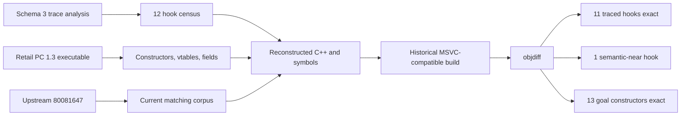

# NFS Most Wanted PC 1.3 full-trace source reconstruction

> Date: 2026-09-13  
> Scope: owner-operated retail executable, gameplay trace analysis, and matching C++ repository  
> Reconstruction commit: `4b662e80` on `feature/pc-zanim-match`

## Executive summary

The latest public repository changes through `80081647` were merged first and the upstream-based corpus rebuilt successfully. The reconstruction now covers everything represented in the supplied schema-3 trace analysis: all 12 configured function-entry hooks, ten dynamically observed goal types, five vehicle types, task-field correlations, pursuit-spawn entries, and helicopter-fuel samples. Eleven traced functions compile to a 100% retail match; `AICopManager::SpawnPursuitIVehicle` is exact-sized at 1,536 bytes and 99.846695%, with only an equivalent final branch layout remaining. All 13 statically mapped goal constructors are also 100%, including a corrected `AIGoalRam`/`AIGoalStopShort` identity. The whole zAI unit is not complete: the current upstream-based report has 64,536 of 246,278 exact code bytes and 659 of 3,506 exact functions.

## Source location and Git state

- Repository: `/Users/tihan-nico/.codex/worktrees/1a8f/NFS MW Remaster/Library/PCDecompilation/nfsmw-pc-match`
- Requested upstream: `80081647` (`origin/main`)
- Upstream merge: `3493f5fd`
- Reconstruction: `4b662e80`
- Branch: `feature/pc-zanim-match`
- Push status: local only; no push or pull request created

The merge retained the newer upstream `FEDatabase.hpp` implementation at the only conflict. A complete build succeeded before and after the reconstruction.

## Trace identity and evidence boundary

The derived capture has schema version 3, capture id `3b4641467dd7270d42f3e20009bfa363`, 100,000 entry events, 24 checkpoints, and one terminal event. Its target SHA-256 matches the authorized retail `SPEED.EXE` (`80774c2e5d619b4f120b48d4462896fd504c263399d203a238769cffde1d253c`) and its hook catalogue matches the local catalogue.

This is entry-only evidence. It does not prove return values, successful spawns, exact state transitions between samples, or unique object lifetimes where allocator addresses may be reused. The raw 2026-09-12 event stream is not present, so the corrected derived JSON was syntax-validated but could not be regenerated from raw events during this pass.

## Complete traced-function result

| Trace hook | Entries | Size | Match |
|---|---:|---:|---:|
| `AIGoal::ChooseAction` | 62,633 | 178 | 100% |
| `AIVehicle::OnTaskSimulate` | 15,992 | 52 | 100% |
| `AITrafficManager::SpawnTraffic` | 12,167 | 406 | 100% |
| `AICopManager::OnTask` | 3,385 | 109 | 100% |
| `AIPursuit::OnTask` | 1,930 | 4,415 | 100% |
| `AITarget::TrackAll` | 1,693 | 62 | 100% |
| `AIVehicle::Update` | 1,011 | 297 | 100% |
| `AITrafficManager::OnTask` | 432 | 32 | 100% |
| `Gps::Update` | 432 | 815 | 100% |
| `AICopManager::SpawnPursuitIVehicle` | 284 | 1,536 | 99.846695% |
| `AIVehicleHelicopter::Update` | 36 | 288 | 100% |
| `AIVehicleRacecar::Update` | 5 | 189 | 100% |

`AIVehicleHelicopter::UpdateFuel` is a supplemental 112-byte exact function. The pursuit-spawn residual is a retail `jne success; jmp failure` versus rebuilt `je failure; jmp success`; the two layouts return the same Boolean result, but the function is intentionally not called byte-identical.

## Reconstructed contracts

The reconstruction commit changes 13 repository files (140 insertions, 91 deletions):

- `UListable.h`: corrects `ListableSet` backing storage to `ListSize * 2` and restores inline `First()` behavior.
- `UVectorMathCPU.hpp`: restores retail `p1 - p2` XZ distance operand order.
- `AIMath.h`: reconstructs the original `FloatSpring::Integrate` update sequence, making `AIVehicle::Update` exact.
- `AITrafficManager.cpp`: restores complete-object task documentation and two-stage 0.75 traffic start-speed scaling.
- `AICopManager.cpp`: restores cooldown/filter flow, spawn-vector order, and invalid-position/reset guards.
- `AIPursuit.h/.cpp`: records the retail task offsets and restores clamp, comparison, literal, and state-store expression order.
- `AIGoal.cpp`: reconstructs `AIGoalPullOver` action registration and initial action selection.
- `Gps.cpp`: restores state ordering, explicit historical x87 dot-product order, and VU0 unit/distance helpers; `Gps::Update` is now 100%.
- `AIVehicleHelicopter.h`: records the retail complete-object fuel offset separately from declaration metadata.
- `OnlineManager.hpp/.cpp`: reconstructs `mOnlineRace` layout and `mOnlineRace || Online::IsInitialized()`.
- `symbols.json`: identifies math/query functions, goal constructors and vtables, constants, and exception-handler symbols.

## Goal, vehicle, and field reconstruction

The dynamic goal census contains Pursuit (28,935 entries), Traffic (16,226), StaticRoadBlock (8,412), FleePursuit (2,706), HeliPursuit (2,079), HeadOnRam (1,886), Ram (1,361), Racer (567), Patrol (265), and HeliExit (196). The former classification of vtable `0x00892c88` / constructor `0x0043b9b0` as StopShort was wrong: constructor vtable assignment and action-string relocations establish it as `AIGoalRam`. `AIGoalStopShort` is vtable `0x00892c64` / constructor `0x0043b8c0`.

Thirteen mapped constructors—Traffic, Patrol, Pursuit, StopShort, Ram, Pit, PullOver, HeadOnRam, StaticRoadBlock, FleePursuit, HeliPursuit, HeliExit, and Racer—are each 100%. The vehicle census covers Traffic, CopCar, Empty, Human, and Helicopter.

Runtime handle values corroborate retail complete-object fields: `AICopManager` task at `0x80`, `AITrafficManager` task at `0x5c`, and `AIPursuit` simulate/busted tasks at `0x54`/`0x58`. Helicopter fuel is read at retail offset `0x7d8`; two observed sequences had only nonincreasing samples and one fell from 60 seconds to zero. These are complete-object offsets and deliberately remain distinguished from surviving declaration metadata.

## Final verification

- Complete `ninja` build: passed (existing incomplete-corpus warnings only)
- `git diff --check`: passed
- Analyzer Python compilation: passed
- Runtime-trace Python tests: 36 passed
- Capture JSON and build report JSON parsing: passed
- `origin/main` ancestry: passed
- Source worktree after commit: clean
- Global corpus: 22.029325% fuzzy; 325,451 / 4,183,964 exact code bytes; 3,156 / 46,126 exact functions
- zAI: 64.2986% fuzzy; 64,536 / 246,278 exact code bytes; 659 / 3,506 exact functions

Absolute metrics are used because the upstream merge changed the report's function and byte denominators, making the older pre-upstream delta unsuitable as a current baseline.

## Reconstruction flow



## Reproduction

```bash
cd '/Users/tihan-nico/.codex/worktrees/1a8f/NFS MW Remaster/Library/PCDecompilation/nfsmw-pc-match'
git merge-base --is-ancestor origin/main HEAD
ninja
jq '{all:.measures,zAI:(.units[]|select(.name=="main/Speed/Indep/SourceLists/zAI")|.measures)}' build/SPEED_EXE_1_3/report.json
git diff --check
```

## Evidence package

- Full reverse-skill case report: `/Users/tihan-nico/Documents/Codex/2026-09-11/se/reverse-skill/work/nfsmw-pc13-full-trace-source-reconstruction-20260913/report/nfsmw-pc13-full-trace-source-reconstruction.md`
- Function matrix: `/Users/tihan-nico/Documents/Codex/2026-09-11/se/reverse-skill/work/nfsmw-pc13-full-trace-source-reconstruction-20260913/evidence/artifacts/E-005-function-matrix.tsv`
- Editable diagram: `/Users/tihan-nico/Documents/Codex/2026-09-11/se/reverse-skill/work/nfsmw-pc13-full-trace-source-reconstruction-20260913/diagrams/full-trace-reconstruction-callflow.mmd`
- Evidence records and timeline: `/Users/tihan-nico/Documents/Codex/2026-09-11/se/reverse-skill/work/nfsmw-pc13-full-trace-source-reconstruction-20260913/`

## Remaining limits

The trace-covered surface is reconstructed, but unobserved parts of zAI and the broader executable remain incomplete. `SpawnPursuitIVehicle` should remain classified as semantic-near until its compiler branch layout is reproduced. A new raw capture would be required to regenerate and independently revalidate the corrected dynamic analysis.
