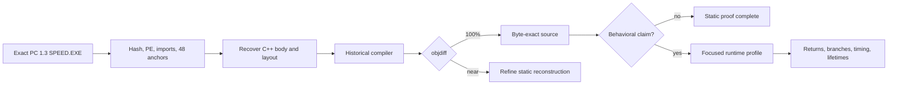

# NFS Most Wanted PC 1.3 static recovery and runtime boundary

> Analysis date: 2026-09-13  
> Scope: owner-operated local executable, matching C++ corpus, and existing runtime evidence  
> Report flavor: ordinary reverse engineering (`flavor = null`)  
> Case: [`work/20260913-nfsmw-pc-static-runtime/scope.md`](work/20260913-nfsmw-pc-static-runtime/scope.md)

## Executive summary

The current PC target does **not** require runtime unpacking before it can be decompiled. The exact PC 1.3 `SPEED.EXE` is a conventional, readable PE32 i386 image with a rich import table, 48 statically validated AI anchors, a symbol map, recovered C++, and an objdiff build report. Static work can therefore continue across every mapped function body; runtime should be reserved for questions that machine code alone cannot answer: which paths execute, what calls return, exact transition timing, object lifetime, and hardware-, asset-, or state-dependent outcomes.

The latest committed reconstruction (`4b662e80`) proved the method on the existing gameplay trace: 11 traced bodies and 13 goal constructors became byte-exact, while `AICopManager::SpawnPursuitIVehicle` became exact-sized and 99.846695% with equivalent control flow. The current local worktree has another 21 modified files and a newer generated report: 374,919 of 4,183,974 code bytes (8.9608345%) and 3,402 of 46,126 functions (7.3754497%) are exact, with 22.750614% global fuzzy similarity. These newer numbers are an observed dirty snapshot, not a committed baseline.

## Scope and target identity

| Attribute | Value |
|---|---|
| Target | `speed.exe` PC 1.3 |
| Format | PE32 GUI executable, Intel i386 |
| Preferred image base | `0x00400000` |
| SHA-256 | `80774c2e5d619b4f120b48d4462896fd504c263399d203a238769cffde1d253c` |
| Matching branch / HEAD | `feature/pc-zanim-match` / `4b662e8098228b6afca20652201ad1fc374a7738` |
| Worktree state | 21 pre-existing modified files |
| Network / execution | Offline; no target execution in this pass |

The dormant clone at `Library/DrivingMechanicsResearch/nfsmw.partial` contains Git metadata but no checked-out source files. The usable PC matching corpus is the existing worktree at `/Users/tihan-nico/.codex/worktrees/1a8f/NFS MW Remaster/Library/PCDecompilation/nfsmw-pc-match`.

## What static recovery can do now

There is no code-visibility gate requiring runtime. The following are already statically recoverable from the retail image and local corpus:

| Recoverable artifact | Available evidence | Completion test |
|---|---|---|
| Function boundaries and machine-code bodies | PC report covers 46,126 functions; symbol/config maps and 48 validated AI anchors exist | Address and size agree with retail |
| C++ control flow, arithmetic, constants, and call order | Existing reconstructed source plus retail disassembly/bytes | Historical compiler output reaches 100% objdiff |
| Vtables, constructors, virtual possibilities, and class-field accesses | Relocations, constructor stores, symbols, and live-offset correlations | Exact body/layout or independently corroborated offset |
| Direct imports and platform dependencies | Readable 14-DLL import directory | Import directory parse |
| Static algorithms for AI, physics behavior, world/track, audio, animation, frontend, and engine support | Named PC source-list units in current build report | Per-function exact/near/unresolved classification |
| The 36 AI catalogue hooks not seen by the survey | Every catalogue prolog validates against the exact sample | Recover and objdiff each body; runtime is not needed to obtain the code |

The productive static loop is the one already demonstrated locally: exact sample identity → preferred-image VA and symbols → reconstructed C++ → historical compiler → objdiff → exact, semantic-near, or unresolved. Runtime data can prioritize functions and validate field interpretations, but it cannot replace this loop or yield byte-exact source by itself.

## Current PC static work queue

The table below uses the current generated PC report, not the older multi-platform feature audit. “Exact” is literal matched code; “fuzzy” is similarity and must not be presented as recovered or player-facing completion.

| Priority | PC unit | Exact code | Exact functions | Fuzzy | Assessment |
|---:|---|---:|---:|---:|---|
| 1 | `zAI` | 94,892 / 246,288 (38.53%) | 808 / 3,506 (23.05%) | 72.99% | Best-supported queue: symbols, traces, layouts, exact exemplars, and many near bodies |
| 2 | `zPhysicsBehaviors` | 77,093 / 196,879 (39.16%) | 576 / 2,337 (24.65%) | 61.58% | Strong existing source; statically recover behavior bodies, then runtime-test outcomes |
| 3 | `zBWare` | 7,582 / 35,235 (21.52%) | 117 / 467 (25.05%) | 54.94% | Small utility/math substrate; high leverage for dependent units |
| 4 | `zWorld2` | 23,526 / 150,787 (15.60%) | 200 / 1,666 (12.00%) | 51.16% | Collision, road, path, trigger, and world math are statically accessible |
| 5 | `zWorld` | 20,425 / 176,380 (11.58%) | 231 / 1,634 (14.14%) | 48.01% | Broad vehicle/world/render connection code; larger dependency surface |
| 6 | `zTrack` | 9,814 / 60,500 (16.22%) | 96 / 830 (11.57%) | 48.15% | Track/path/scenery code can be recovered offline; asset behavior needs validation |
| 7 | `zEcstasy` | 13,412 / 69,449 (19.31%) | 156 / 1,066 (14.63%) | 48.82% | Rendering/model logic is visible, but runtime/driver state matters for outcomes |
| 8 | `zAttribSys`, `zAnim`, `zMisc` | 28,180 exact bytes combined | 328 exact functions combined | 39.67–44.87% | Useful independently bounded static queues |

Lower-static-context PC units should not be mislabeled runtime-only. `zGameplay`, `zDynamics`, `zGameModes`, `zMission`, `zPlatform`, `zSpeech`, and `zMiscSmall` currently lack measured similarity in the generated report; `zCamera`, `zFoundation`, and `zPhysics` are under 2% exact bytes. Those areas require more address/symbol/source recovery work, but the code is still present in the PE and remains a static decompilation problem first.

### Already demonstrated as source-recoverable

The committed gameplay-trace reconstruction provides concrete proof rather than a general promise:

- 11 of the 12 traced functions compile byte-identically to retail.
- `AICopManager::SpawnPursuitIVehicle` is 1,536 bytes and 99.846695%; the remaining branch layout is semantically equivalent but is correctly not called exact.
- 13 goal constructors are exact: Traffic, Patrol, Pursuit, StopShort, Ram, Pit, PullOver, HeadOnRam, StaticRoadBlock, FleePursuit, HeliPursuit, HeliExit, and Racer.
- Static plus runtime correlation recovered task offsets `+0x80`, `+0x5c`, `+0x54`, and `+0x58`, and helicopter fuel at complete-object offset `+0x7d8`.
- The local target validator binds all 48 catalogue prologs to the exact executable, giving a ready address ledger for the next static batch.

## What genuinely requires runtime

“Requires runtime” means the claim is about an execution instance, not that the underlying function cannot be decompiled.

| Runtime question | Why static code is insufficient | Smallest useful capture |
|---|---|---|
| Boolean/pointer returns and successful spawn counts | The current schema records entries only; calls to spawn/validate routines are attempts | ABI-aware exit/result capture for the selected functions |
| Actual branch and virtual-target distribution | Static analysis gives possible paths/targets, not which are selected in a race | Entry plus branch/target counters for one scenario |
| Scheduler cadence, duration, and exact state transitions | Sample ordering is not an instruction-exact transition timestamp | Entry/exit timestamps and selected pre/post state fields |
| Unique object lifetime | Allocator addresses can be reused | Allocation/free hooks or stable generation IDs |
| Controller and frontend navigation | The AI survey contains no DirectInput or frontend/menu hooks | Input-device enumeration/state plus frontend action mapping and returns |
| Traffic pooling, admission, despawn, and quotas | Source shows policy; runtime supplies population, success, and state history | Traffic-focused profile covering hooks 19–25 and relevant results |
| Pursuit, roadblock, helicopter, and target lifecycle | Source shows conditions; runtime confirms scenario reachability and outcomes | Pursuit/helicopter/navigation profiles covering hooks 27–48 |
| Physics, graphics, audio, and asset-driven outcomes | Results depend on frame state, loaded attributes/assets, device/driver, and external DLL behavior | Deterministic scenario with inputs and selected state/output probes |
| Dynamically resolved dependencies | `LoadLibraryA`/`GetProcAddress` exposes possibility, not actual module/function choices | Loader resolution log for a controlled run |

### Existing runtime visibility

The validated derived schema-3 analysis contains 100,000 function-entry events, 24 checkpoints, and one terminal event for the exact sample. It observed 12 survey hooks: goal choice, vehicle simulation/update, traffic spawn/task, cop/pursuit tasks and spawn attempts, target tracking, GPS update, racecar update, and helicopter update.

That capture proves reachability and sampled field values. It explicitly does **not** prove function return values, successful spawns, exact state changes between samples, call duration, or unique object lifetimes. The raw 102,441,984-byte event stream is not present locally now, so the derived JSON cannot be regenerated in this pass. Thirty-six catalogue hooks remain statically located but runtime-unobserved; they divide naturally into core, racer, traffic, pursuit/roadblock, helicopter, and navigation profiles.

## Recommended next sequence

1. Freeze or commit the current 21-file PC worktree before treating 8.9608345% as a durable baseline.
2. Finish the dirty AI batch first and run per-function objdiff; it has the highest existing fuzzy context and the best trace/symbol support.
3. Move next to `zPhysicsBehaviors`, then the small `zBWare` substrate, before attacking low-context gameplay/frontend units.
4. Keep every result in three classes: byte-exact, semantic-near, unresolved. Do not convert fuzzy percentages into “decompiled” claims.
5. Only after a static body exists, request focused runtime evidence for its unresolved behavioral claim. Start with return-aware spawn/validation, then the missing racer/traffic/pursuit/helicopter/navigation profiles.
6. Treat controller/menu investigation as a separate DirectInput/frontend capture; the existing AI trace has no evidence for it.

## Evidence, findings, and solve path

| Evidence | Source | Reproduction | Result |
|---|---|---|---|
| E-001 | Exact retail sample and matching worktree | `validate_target.py`, `git rev-parse`, `git status --short` | PC 1.3 identity and current dirty state validated |
| E-002 | Current `report.json` | Focused `jq` measures by unit | Exact and fuzzy static coverage quantified |
| E-003 | Derived schema-3 analysis and hook catalogue | Focused `jq` identity, boundary, census | 12/48 entry visibility and explicit limitations validated |
| E-004 | Existing local PE/import triage | Read report PE/import section | Readable IAT and no ordinary packer indication |

The formal Evidence records are in [`work/20260913-nfsmw-pc-static-runtime/evidence`](work/20260913-nfsmw-pc-static-runtime/evidence).

### Findings

- F-001, high confidence: static source recovery is not blocked on target execution.
- F-002, high confidence: AI and physics behaviors are the best-supported next static queues.
- F-003, high confidence: existing runtime evidence proves reachability but not results or transitions.
- F-004, high confidence: 36 statically validated AI hooks still need focused execution only for behavioral answers.

### Solve path



Editable diagram source: [`work/20260913-nfsmw-pc-static-runtime/report/static-runtime-boundary.mmd`](work/20260913-nfsmw-pc-static-runtime/report/static-runtime-boundary.mmd).

## Reproduction commands

```bash
cd '/Users/tihan-nico/NFS MW Remaster'

/usr/local/bin/python3 Tools/AI/RuntimeTrace/validate_target.py \
  --target '/Users/tihan-nico/.codex/worktrees/1a8f/NFS MW Remaster/Library/PCDecompilation/nfsmw-pc-match/orig/SPEED_EXE_1_3/speed.exe' \
  --catalogue Tools/AI/RuntimeTrace/hook_catalogue.json

jq '{all:.measures,zAI:(.units[]|select(.name=="main/Speed/Indep/SourceLists/zAI")|.measures)}' \
  '/Users/tihan-nico/.codex/worktrees/1a8f/NFS MW Remaster/Library/PCDecompilation/nfsmw-pc-match/build/SPEED_EXE_1_3/report.json'

jq '{capture_identity,interpretation_boundary,hook_census}' \
  Tools/AI/RuntimeTrace/capture-20260912-205005-gameplay-analysis.json
```

## Limitations

- No game process was started and no new hook was deployed in this pass.
- Ghidra, IDA, radare2, Binary Ninja, and Frida are not currently available in the refreshed reverse-skill tool index; this assessment uses the established local validator, matching compiler/objdiff report, source corpus, and prior capture evidence.
- The current objdiff measures are generated from a dirty worktree. The last committed reconstruction reported lower figures: 325,451 / 4,183,964 exact code bytes and 3,156 / 46,126 exact functions globally; zAI was 64,536 / 246,278 exact bytes and 659 / 3,506 exact functions.
- PE entropy and the rich import table provide no ordinary packer indication, but they do not prove the absence of every protection or dynamically resolved dependency.
- Timeline and work-item traceability are recorded in [`work/20260913-nfsmw-pc-static-runtime`](work/20260913-nfsmw-pc-static-runtime).
