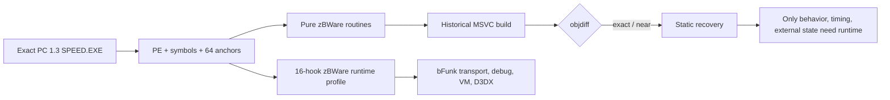

# zBWare PC reconstruction

## Outcome

The deterministic core of zBWare has been reconstructed in the matching PC decompilation worktree and now builds as a historical-MSVC translation unit. The work covers containers, chunk loading, fixed/floating-point math, vectors, quaternions, matrices, strings/shared strings, SpeedScript parsing, memory accounting, slot pools, printf setup, and bFunk packet headers.

The work is recorded as an authorized offline reverse-engineering case in [the case report](</Users/tihan-nico/NFS MW Remaster/work/20260913-nfsmw-pc-zbware-reconstruction/report/zbware-reconstruction.md>), with append-only [timeline](</Users/tihan-nico/NFS MW Remaster/work/20260913-nfsmw-pc-zbware-reconstruction/timeline.md>), [Evidence records](</Users/tihan-nico/NFS MW Remaster/work/20260913-nfsmw-pc-zbware-reconstruction/evidence), and an anonymized [field journal](</Users/tihan-nico/NFS MW Remaster/work/20260913-nfsmw-pc-zbware-reconstruction/field-journal.md>).

## What was reconstructed

- `bList`: list splicing, sorted insertion, bottom-up merge sort, and traversal helpers.
- `bChunk`: child counting, loader lookup/dispatch, alignment verification, and chunk validation helpers.
- `bMath`: fixed reciprocal, restoring integer square root, fixed sine/sine-cosine table interpolation, legacy and interpolating atan paths, polar conversion, and existing CRC/fmod semantics.
- `bVector`/`bQuaternion`: vector arithmetic, bounding boxes, distance/area helpers, quaternion Hamilton product/normalization/conjugation, and quaternion-to-matrix conversion.
- `bMatrix`: identity/copy construction, affine inversion, determinant/inverse helpers, matrix multiplication/transpose semantics, and spline basis evaluation.
- `Strings`: bounded and case-insensitive string operations, UTF-16/shared-string helpers, pool lifecycle, and index lookup.
- `SpeedScript`: constructors, command/argument peeking, cursor wrappers, include handling, and argument conversion wrappers.
- `bMemory`/`bSlotPool`: empty/count/find allocation queries, allocator routing, integrity checks, range and single-slot free paths, and lifecycle helpers.
- `bPrintf`/`bFunk`: terminal printf adapter and packet-header accessors/return-header setup.

Representative source files are [bMath.hpp](</Users/tihan-nico/.codex/worktrees/1a8f/NFS MW Remaster/Library/PCDecompilation/nfsmw-pc-match/src/Speed/Indep/bWare/Inc/bMath.hpp>), [bMath.cpp](</Users/tihan-nico/.codex/worktrees/1a8f/NFS MW Remaster/Library/PCDecompilation/nfsmw-pc-match/src/Speed/Indep/bWare/Src/bMath.cpp>), [bVector.cpp](</Users/tihan-nico/.codex/worktrees/1a8f/NFS MW Remaster/Library/PCDecompilation/nfsmw-pc-match/src/Speed/Indep/bWare/Src/bVector.cpp>), [bMatrix.cpp](</Users/tihan-nico/.codex/worktrees/1a8f/NFS MW Remaster/Library/PCDecompilation/nfsmw-pc-match/src/Speed/Indep/bWare/Src/bMatrix.cpp>), and [SpeedScript.cpp](</Users/tihan-nico/.codex/worktrees/1a8f/NFS MW Remaster/Library/PCDecompilation/nfsmw-pc-match/src/Speed/Indep/bWare/Src/SpeedScript.cpp>).

## Match evidence

The exact sample is the Intel 80386 PC PE with image base `0x00400000`, image size `6,786,638`, and SHA-256 `80774c2e5d619b4f120b48d4462896fd504c263399d203a238769cffde1d253c`. The schema-4 validator accepted all 64 configured anchors, including the 16-hook zBWare runtime profile.

The focused zBWare object comparison is:

| section | size | fuzzy match |
|---|---:|---:|
| `.text` | 35,235 | 59.85073% |
| `.rdata` | 2,192 | 47.451748% |
| `.data` | 6,516 | 25.858124% |
| `.bss` | 13,104 | 6.3682847% |

The regenerated report gives the zBWare unit-level score as `59.901512%`, with `9,121/35,235` matched code bytes and `129/467` matched functions. Exact/near examples include `bList::Sort` 100%, `bList::MergeSort` 100%, `bCalculateCrc32` 67.69231% with equivalent control flow, and `bInvertMatrix` 85.52027%. These are static comparison measures, not claims of live behavioral equivalence.

## What still requires runtime or platform work

The remaining boundary is explicit rather than guessed:

- `bFunkPlat.cpp` transport, server discovery, asynchronous dispatch, and checksum integration depend on platform/network state and remain stripped or unverified.
- `bDebug.cpp` ticker, file-checker, interrupt, and debug-output paths depend on OS/runtime services.
- `bMemory.cpp` VM/tracing/fancy-stomp and allocator placement behavior requires a live process and the original memory environment.
- Retail imports `D3DXMatrixTranspose` from `d3dx9_26.dll`; the source has an alias-safe CPU transpose fallback, but byte parity with that external implementation requires the dependency and matching toolchain.
- A controlled schema-4 `zbware` run observed 3,313 entry records over 588.49 seconds and reached 12 of the 16 enabled hooks. The decoded artifacts are in [the zBWare capture package](</Users/tihan-nico/NFS MW Remaster/Tools/AI/RuntimeTrace/captures/2026-09-13-zbware/README.md>). The game exited before the stop request was consumed, so this is a digest-valid contiguous runtime prefix, not a terminally sealed or certified-lossless capture. Return values, allocation success, timing per call, external transport behavior, and semantic pool-field identities remain open.

## Runtime evidence

The run reached ticker initialization and sampling, pool initialization/close,
free-memory insertion, sampled allocation and integrity verification, global
memory initialization, and sampled `bWareMalloc`. It observed pool IDs
`2, 3, 4, 5, 6, 9`, initialized pool sizes from `327680` through `51200000`,
allocation alignments `16`, `64`, and `128`, and a `60000.0` ticker wraparound
input. `bReleasePutString`, `bLaunchWindows`, `bHasTickerExpired`, and
`MemoryPool::TraceNewPool` were not reached in this scenario; absence from one
sampled run is not proof that they are unused.

The prefix has physical sequence `1..3313`, valid header/manifest/record
digests, no tail bytes, and no observed queue loss, budget rejection, read
fault, or write failure. It has no terminal record because the process had
already exited, so the integrity decoder correctly refuses complete/lossless
certification. The installed tracer config was returned to `enabled=0`.

## Reproduction

From the matching worktree:

```text
ninja build/SPEED_EXE_1_3/src/Speed/Indep/SourceLists/zBWare.obj
build/tools/objdiff-cli diff -p . -u 'main/Speed/Indep/SourceLists/zBWare' -o /tmp/zbware-final.json --format json
```

From the project root, validate the authorized sample:

```text
python3 Tools/AI/RuntimeTrace/validate_target.py \
  --target "/Users/tihan-nico/.codex/worktrees/1a8f/NFS MW Remaster/Library/PCDecompilation/nfsmw-pc-match/orig/SPEED_EXE_1_3/speed.exe" \
  --catalogue Tools/AI/RuntimeTrace/hook_catalogue.json
```

The case review is run with:

```text
python3 /Users/tihan-nico/Documents/Codex/2026-09-11/se/reverse-skill/skills/case-review/scripts/review_case.py \
  work/20260913-nfsmw-pc-zbware-reconstruction --verify-hashes --strict
```

Unrelated pre-existing dirty-tree changes were preserved; this reconstruction only adds to the zBWare work already present in the matching worktree.

## Static-to-runtime flow


