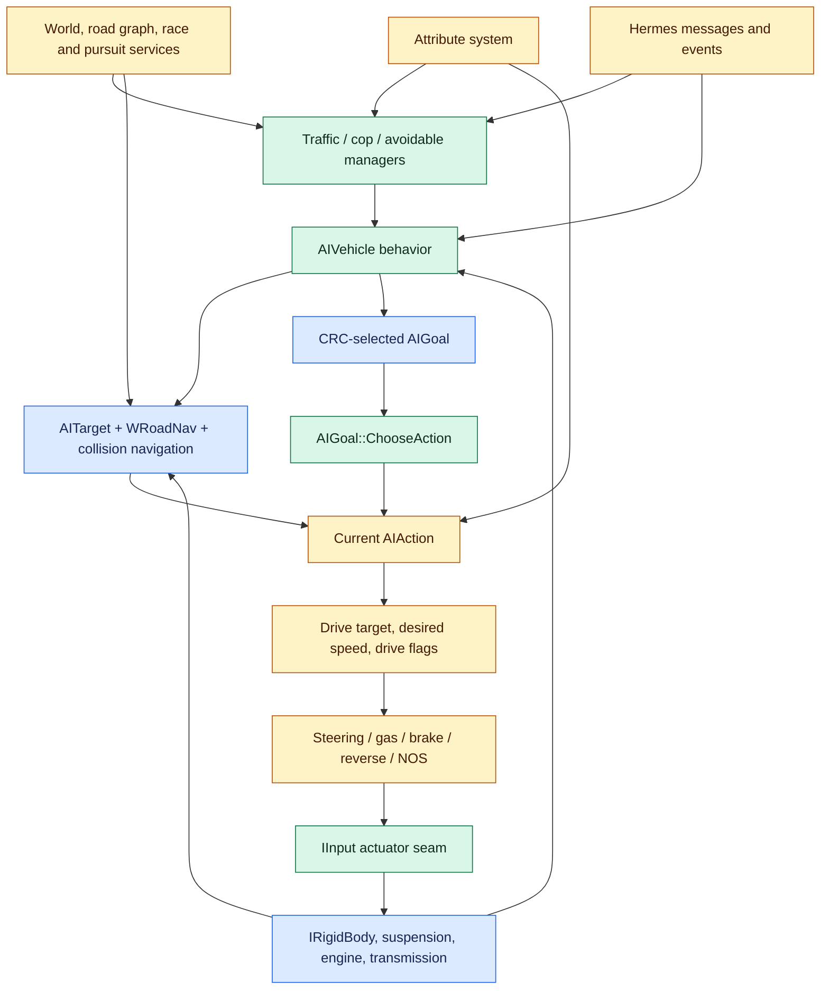

# Need for Speed: Most Wanted PC 1.3 AI system contract

This document is the confidence-bounded behavioral contract recovered for the
complete `main/Speed/Indep/SourceLists/zAI` object unit. It is intended to guide
analysis, tests, and a future clean-room-style Unity port. It is not a claim
that the whole retail AI system has been reproduced.

## Completion boundary

The installed executable and corpus oracle are byte-identical, and the entire
zAI unit has been inventoried. The upstream object report still marks the unit
`complete=false`: 556 of 3,696 reported functions are exact matches, 205 are
near matches, 128 are partial matches, and 2,807 are unmatched. Of the
unmatched entries, 2,730 are unidentified original functions. Consequently:

- exact functions may define machine-code-backed behavior;
- near functions may define high-confidence behavioral contracts;
- partial functions may supply candidate structure and constants only;
- unmatched or stripped functions are explicit fidelity holes;
- source task-time values are not automatically wall-clock seconds;
- no current Unity AI implementation is declared retail-equivalent by this
  document.

The current frozen evidence ledger is
[`zai-evidence.json`](zai-evidence.json). The full pursuit subsystem has a
separate, more detailed contract in
[`../Pursuit/PORT_CONTRACT.md`](../Pursuit/PORT_CONTRACT.md); this document
summarizes that subsystem at its integration boundary.

The project ledger is evidence version 2 (SHA-256
`c39a0709a8a42e0bb69b98a34e2862ceb43f247ba3fd220b6964ee2473a6f3ae`).
During analysis, the active upstream objdiff `report.json` improved while the
source manifest stayed byte-identical. The case preserves the earlier v1
snapshot (`4cf046636d4d0634973b4bb32e6e5efff728b21c48ed8485e1955cb4620d0735`)
and records v2 as a superseding observation; the improvement is not treated as
silent metadata drift. A later active-report hash changed only the ledger's
`.input_manifest_sha256` and `.inputs` provenance fields; the canonicalized
semantic projection remained byte-identical to v2. The case records that
post-freeze observation separately rather than manufacturing a semantic v3.

## Evidence basis

| Property | Current v2 value |
|---|---:|
| Target | NFSMW PC 1.3 `speed.exe`, PE32 x86 |
| Installed/corpus SHA-256 | `80774c2e5d619b4f120b48d4462896fd504c263399d203a238769cffde1d253c` |
| Executable size | 6,029,312 bytes |
| zAI preferred-image range | `[0x00401050, 0x00446a8f)` |
| zAI code / data | 250,735 / 21,008 bytes |
| Reported functions | 3,696 |
| Demangled functions | 966 |
| Exact / near / partial / unmatched | 556 / 205 / 128 / 2,807 |
| Identified zAI or adjacent contracts | 664 functions |
| Identified engine contracts | 75 functions |
| Identified dependencies | 227 functions |
| Unidentified generic / named gaps | 2,628 / 102 functions |
| AI source/header files | 53 files, 18,724 lines |
| Translation-unit includes | 36 |
| Source recovery markers | 61 `TODO`/`FIXME`/`UNSOLVED`/`STRIPPED` records |

The objdiff percentage is a code-similarity measure, not a probability. A
weighted subsystem percentage is byte-weighted. Every `va_start` in the ledger
is a preferred-image virtual address from the symbol map; an objdiff unit
offset is not an executable address.

### Controlled gameplay observation

The fixed capture under
[`RuntimeTrace/captures/2026-09-11-gameplay`](RuntimeTrace/captures/2026-09-11-gameplay/README.md)
adds runtime evidence for selected paths on the same executable. The
291.2530456-second trace contains 15,386 records forming 7,693 exact entry/exit
pairs. Sequences are contiguous from 1 through 15,386, the tracer reported zero
drops, and the decoder found no duplicate, unmatched, hook-mismatched,
return-address-mismatched, or `this`-mismatched events.

All nine configured anchors executed. Full-rate hooks recorded 3,803
`AIGoal::ChooseAction` calls, 1,920 traffic-spawn attempts, 54 normal
spawn-location calls, nine spawn-position checks, and 11 pursuit-vehicle spawn
attempts. Sampled observations bound vehicle simulation to 201,729–201,856
calls, vehicle think tasks to 12,993–13,056, pursuit tasks to 1,297–1,312, and
formation updates to 257–264 for this run.

Successful results included 89 traffic spawns, three normal spawn locations,
three accepted spawn positions, and one pursuit-vehicle spawn. Observed current
action states at goal-choice return were `AIActionTraffic` 3,516 times at score
0.1, `AIActionRace` 200 times at score 0, and `AIActionPursuitOffRoad` 87 times
at score 0.01. Vehicle snapshots contained drive masks 0, 3, and 7. These data
prove execution and concrete values for the instrumented paths; they do not
prove uninstrumented branch coverage, causal scheduler policy, or exact behavior
at stripped/partial recovery sites.

The producing tracer was version 0.1/schema 1. Its call/result records and raw
snapshots are intact, but several specialized slots used non-retail header
offsets. Decoder 0.2 ignores those labels and re-decodes only fields whose
retail offsets were validated against the exact binary. Task-hook snapshots are
normalized from the `Sim::IActivity` subobject to their complete-object base,
and `HSIMTASK` values are treated as small integer handles. Tracer 0.2/schema 2,
with corrected retail fields, was built, target-validated, and installed for
future captures.

Tracer 0.3.4/schema 3 is now statically ready for broader, profile-scoped
observation. It expands the exact-target catalogue from nine to 48 entry hooks
across core, racer, traffic, pursuit, helicopter, navigation, survey, and all
presets; captures raw regions with validity masks; and embeds the resolved
manifest, sampling indices, loss/budget counters, target/config/catalogue
digests, header digest, and per-record digests. Schema 3 is deliberately
entry-only and has not been installed or run. It therefore adds observability,
not new gameplay evidence, return values, durations, or semantic field claims.

### Recovery classes

| Class | Ledger rule | Permitted use |
|---|---:|---|
| `exact_binary_match` | exactly 100% | Treat the reported function body as machine-code-backed for this oracle. |
| `near_match` | at least 95%, below 100% | Use as a high-confidence behavior contract after inspecting differences. |
| `partial_match` | above 0%, below 95% | Keep replaceable and calibrate against runtime evidence. |
| `unmatched` | 0% or absent match | Do not fill with guessed retail behavior. |

## Architecture



Editable diagrams are in
[`nfsmw-ai-callflow.mmd`](nfsmw-ai-callflow.mmd) and
[`nfsmw-ai-vehicle-cycle.mmd`](nfsmw-ai-vehicle-cycle.mmd).

### Ownership rules

1. `AIVehicle` owns the common per-vehicle runtime: queried engine interfaces,
   two road navigators, target tracking, collision navigation, goal lifetime,
   spawn/simple-physics state, and latched drive intent.
2. `AIGoal` owns an ordered set of candidate `AIAction` instances and exactly
   one current action.
3. An action decides whether it is eligible, produces drive intent, and uses
   engine interfaces; it does not own global traffic or pursuit population.
4. `AITrafficManager`, `AICopManager`, `AIPursuit`, and `AvoidableManager` own
   population, lifecycle, formation, and shared-neighborhood policy.
5. `AITarget` represents either a tracked simable or an explicit
   position/direction. `WRoadNav` owns road-graph projection and path walking.
6. `IInput` is the normal actuator boundary. `IRigidBody`, `IEngine`,
   `ITransmission`, `ISuspension`, and vehicle performance interfaces are the
   feedback boundary.
7. Generated attributes and messages are external contracts. A port must not
   replace them with hard-coded frontend policy.

## Per-vehicle execution cycle

### Construction and reset

`AIVehicle::Construct` is exact at `0x0043cf40`. Construction attaches the
behavior to its simable, queries its vehicle/input/rigid-body and related
interfaces, creates a drive-to navigator and a future-position navigator,
constructs its target and collision-navigation state, and creates simulation
tasks. `ResetInternals` is exact at `0x00414ce0` and clears transient navigation,
driving, target, spawn, collision, and override state without redefining the
external vehicle.

The runtime must re-query behavior interfaces when a mechanic changes. Actions
likewise implement `OnBehaviorChange`; caching Unity components forever would
not match this contract.

### Think and simulate phases

The recovered split is intentional:

1. A think task calls `AIVehicle::OnTask` (95.35714% near at `0x004082d0`).
2. If simulation is paused or the race is ending, the think path does not run
   normal policy.
3. Otherwise it clears the current drive flags, updates target/navigation and
   subtype policy, then updates the current goal/action.
4. The selected action sets a drive target, desired speed, optional overrides,
   and drive flags.
5. A separate simulation task calls exact `OnTaskSimulate` at `0x004081e0` and
   applies the latched outputs to `IInput`.

This ordering prevents policy code from becoming the physics integrator. A
port should preserve two explicit phases even if both happen in one Unity
frame.

The controlled gameplay run observed both callbacks: 1,577 sampled
`OnTaskSimulate` calls imply 201,729–201,856 total calls at divisor 128, while
204 sampled `OnTask` calls imply 12,993–13,056 at divisor 64. Observed `dT`
ranges were 0.0016666668–0.0083333338 and
0.0060416651–0.33333334 respectively. These are live callback values, not a
complete scheduler model or uninstrumented performance measurements.

### Drive flags and outputs

The observed drive mask is:

| Bit | Value | Behavior |
|---|---:|---|
| steering | `1` | evaluate destination-relative steering |
| longitudinal | `2` | evaluate gas/brake/handbrake for desired speed |
| reverse allowance | `4` | allow reverse/turnaround handling |

Normal movement actions call `DoDriving(7)`. Static or exceptional actions may
write `IInput` directly. The source still marks the backing `mDriveFlags`
member as a recovery TODO, so preserve the observed behaviors rather than
depending on its recovered layout.

### Steering

Common steering derives a horizontal unit vector to `mDest`, compares it with
the rigid body's forward/right basis, and converts cross/dot geometry into a
normalized steering command. Low-speed reverse and turnaround state may invert
or bias steering. The road and collision layers can change the destination
before this step.

The public helpers in `AISteer` include seek, pursuit/ram interception,
separation, wall avoidance, road-edge forces, desired-speed-to-target, and
vehicle separation. Several helper bodies are stripped or partial. In
particular `AISteer::Separation` is only 34.018867% at `0x0040a390` and
`AISteer::Ram` is 99.88278% at `0x00418200`; reproduce their semantics behind
replaceable tests, not as universal exact math.

### Gas, brake, reverse, and NOS

Common longitudinal control compares desired and actual speed, handles current
direction and reverse override, and writes gas/brake/handbrake. The reverse
override is a duration latch used by `AIActionGetUnstuck`. Actions may disable
NOS explicitly or call subtype-specific `DoNOS`; racer and pursuit policies
make separate NOS decisions.

Direct input writers must set every output they own. For example:

- `AIActionStaticRoadBlock`: gas 0, brake 1, steering 0, vertical steering 0,
  handbrake 0, NOS false;
- `AIActionStopShort`: gas 0, brake 1, steering 0, vertical steering 0,
  handbrake 1, NOS false;
- `AIActionAirborne`: gas/brake/steering/vertical/handbrake all 0;
- `AIActionTooDamaged`: outputs neutral, then applies brake 0.25 while no
  longer in shock and still moving at least 2.5 source-speed units.

### Road and collision navigation

The vehicle holds two `WRoadNav` instances: the immediate drive-to navigator
and a future-position navigator. It can reset either with lane-selection modes,
initialize from the current/future pose, find paths, expose remaining path,
and project current and future road positions.

`UpdateRoads` is partial (92.47321% at `0x00442420`). The source contract:

- advances road walkers from current pose and velocity;
- derives current and future road segment/lane state;
- maintains whether the target and navigation destination are drivable;
- predicts future pose and road relationship;
- feeds collision probes and action admission.

Collision navigation samples the world and nearby avoidables ahead, maintains
probe state, and can redirect or constrain the common destination. Because
multiple `AISteer` helpers and a world-collision branch are stripped, a port
must separate road following, dynamic separation, and static-world avoidance
so each can be calibrated independently.

### Target lifecycle

`AITarget` has an exact fixed-capacity global registry of ten live target
objects. `TrackAll` (`0x004237f0`) refreshes registered targets. The three
`Aquire` overloads for simable, position, and position+direction are exact at
`0x00423860`, `0x004238b0`, and `0x00423900`.

A target may:

- track an `ISimable`, reading its rigid-body pose/velocity and allowing
  interface queries;
- hold an explicit point;
- hold an explicit point and direction;
- become invalid and release its simable handle;
- automatically clear when the tracked simable unregisters.

Preserve handle invalidation. A raw Unity object reference without an
unregister path changes action-finish and pursuit behavior.

### Spawn, unspawn, respawn, and simple physics

`AIVehicle` maintains spawn/unspawn/respawn latches and a last-spawn timer.
Spawn transitions reset navigation and vehicle state; unspawn requests remove
the active representation through the owning engine contract. Off-world or
far-away cars may switch to simple physics, which directly advances position,
steers velocity toward the desired destination, and follows road elevation.

`AISpawnManager` owns a shared rotating cache of 50 camera-relevant road
segments. A refresh scans 20 candidate segments and validates five cache slots
per update. Candidate checks cover:

- road/lane validity and non-decision constraints;
- distance from camera/player and optional no-cop ranges;
- visibility/camera exclusion;
- proximity to existing vehicles;
- lane and node suitability.

It can pick a random cached segment and lane. Static correlation is strong: the
subsystem is 92.229146% weighted, `CheckSpawnPosition` is 97.844154% near, and
the 360-byte `GetSpawnLocation` at `0x0042fa40` is 99.3125% near. Runtime tracing
recorded 54 location calls with three successes and nine position checks with
three acceptances. The successful `(segment, lane, time step)` outputs were
`(830, 3, 0.164520263671875)`, `(812, 3, 0.6930084228515625)`, and
`(978, 1, 0.7348785400390625)`; their accepted positions are retained in the
capture analysis. The manager decoded consistently with minimum/maximum spawn
distances 150/400. Four of eight subsystem functions remain partial, so these
examples validate execution and layout without making placement policy
retail-equivalent.

### Skill, performance, and perpetrator glue

`AIVehicle` exposes top speed, acceleration, handling, skill, and catch-up
inputs to actions. `AIVehiclePid` supplies catch-up/performance control and
`AIPerpVehicle`-style behavior tracks heat, hidden zones, pursuit membership,
collision causality, and pursuit cost. These values are sourced from generated
attributes and other vehicle interfaces; they are not constants owned by the
AI action.

The recovered skill domain includes ten normal AI skill levels, `-1` for no
skill, and `-2` for player skill. Opponent strength and difficulty modifiers
are separate enums.

## Goal and action scheduler

### Factory and lifecycle

Goals and actions are registered by CRC name. `AIVehicle::SetGoal` destroys the
old goal and constructs the requested type through the goal factory. Each goal
constructs an ordered action list through the action factory. An action
implements:

```text
CanBeAttempted(dT)
IsFinished()
OnBehaviorChange(mechanic)
BeginAction(dT)
FinishAction(dT)
Update(dT)
ShouldRestartWhenFinished()  // protected, false by default
```

Low score is `0.0`; high score is `1.0`. Traffic, ram, and head-on-ram use
`0.1`, while pursuit-off-road uses `0.01`. Exact `AIGoal::ChooseAction` at
`0x0042b070` works as follows:

1. Read whether the current action is finished and its score (or score 0 with
   no current action).
2. Iterate candidates in list order, excluding the current action.
3. For each eligible candidate, accept it when the current action was finished
   or its score is greater than or equal to the current score.
4. Continue scanning; therefore a later eligible action wins equal-score ties.
5. Finish the old action, set the new action, then begin it.
6. Update the resulting current action.

That tie rule is observable and must be tested. A priority queue or first-wins
selection would differ.

The runtime trace confirms that this exact chooser is active in gameplay. Its
3,803 exits contained 3,516 traffic, 200 race, and 87 pursuit-off-road current
actions. Observed transition classes were none→traffic, none→race,
pursuit-off-road→race, race→pursuit-off-road, and race→traffic. The trace does
not isolate an equal-score tie, so the later-wins-equal rule remains proved by
the exact function body rather than by that mixed scenario.

### Goal composition

| Goal CRC name | Ordered actions | Notes |
|---|---|---|
| `AIGoalNone` | `None` | `None` is never eligible and immediately finished. |
| `AIGoalTraffic` | `Traffic` | Chooses immediately. |
| `AIGoalPatrol` | `Traffic`, `TooDamaged` | Damage override is later and high-score. |
| `AIGoalPursuit` | `PursuitOffRoad`, `Race`, optional `Traffic`, `TooDamaged`, `GetUnstuck`, `Airborne` | Player-owned actors omit `Traffic`; high-score recovery actions can preempt, while later low-score airborne wins an eligible equal-score tie. |
| `AIGoalStopShort` | `StopShort`, `TooDamaged`, `GetUnstuck`, `Airborne` | Breaker stop plus recovery overrides. |
| `AIGoalRam` | `Ram`, `PursuitOffRoad`, `Race`, `TooDamaged`, `GetUnstuck`, `Airborne` | Ram score 0.1 outranks normal low actions. |
| `AIGoalPit` | same as `AIGoalRam` | Goal name changes tactic context/formation. |
| `AIGoalPullOver` | factory returns `AIGoalRam` | Recovered constructor is stripped; source/runtime identity is inconsistent. |
| `AIGoalHeadOnRam` | `HeadOnRam`, `Race`, `TooDamaged`, `GetUnstuck`, `Airborne` | Sets pursuit formation offset `(0,0,-3)`. |
| `AIGoalStaticRoadBlock` | `StaticRoadBlock` | Stationary control. |
| `AIGoalFleePursuit` | `Race`, `TooDamaged`, `GetUnstuck`, `Airborne` | Uses racer navigation to leave. |
| `AIGoalHeliPursuit` | `HeliPursuit`, `TooDamaged` | Helicopter chase/search/strike. |
| `AIGoalHeliExit` | `HeliExit`, `TooDamaged` | Unspawns when exit action finishes. |
| `AIGoalRacer` | `Race`, `GetUnstuck` | Race behavior plus high-score recovery. |

There are fourteen registered goal names in the recovered file. Do not model
`PullOver` as a proven independent goal: its factory explicitly returns
`AIGoalRam`, while the `AIGoalPullOver` constructor is marked `STRIPPED`.

### Action behavior ledger

| Action | Admission / finish | Principal output | Owner weighted match |
|---|---|---|---:|
| `None` | never eligible / finished | no output | 98.28571% |
| `Traffic` | valid traffic interfaces and route; finishes on invalid state | road-following target and traffic speed, flags 3 | 86.211066% |
| `Race` | exact admission against vehicle/nav/race state | curvature/performance/catch-up speed, road target, NOS, flags 7 | 86.328918% |
| `PursuitOffRoad` | target within 60, acceptable road deviation and relative speed, both drivable, not chicken | blended intercept/formation/avoidance, limited speed, NOS mirroring, flags 7 | 72.410889% |
| `Ram` | target/nav drivable, not chicken | target-relative intercept; pull-over avoidance/stop branch; flags 7, NOS off | 75.660738% |
| `HeadOnRam` | target/nav drivable, not chicken | `AISteer::Ram`, 100 kph desired speed, flags 7 | 71.533439% |
| `StaticRoadBlock` | eligible with input/vehicle | full brake, neutral steer, NOS off | 99.05445% |
| `StopShort` | always; finishes when breaker clears | full brake + handbrake, NOS off | 99.041556% |
| `TooDamaged` | vehicle destroyed / never finishes | ends pursuit membership and neutralizes controls | 95.462373% with one unmatched method |
| `GetUnstuck` | gas/vertical input active for 3 source units with less than 3 units movement | 2-source-unit reverse override, 15 desired speed, center-lane reset | 85.792649% |
| `Airborne` | zero grounded wheels for more than 1.5 source units | neutral controls until grounded | 99.517122% |
| `HeliPursuit` | always / 10 source units | chase, search, or skid-strike flight intent | 83.937982% |
| `HeliExit` | always / high-behind distance exit criterion | up → ahead → behind/out flight path, flags 7 | 95.245047% |
| `JackKnife` | hitched trailer and forced message, or >=50 mph with impact time `(0,4.25]` and angle <=25° | 0.5 acceleration, then handbrake and steer -1; unhitch below 10 mph | 99.319847% |
| `Spline` | never eligible / finished | empty update | 98.28571% |
| `Strafe` | never eligible / finished | empty update | 98.28571% |

`JackKnife`, `Spline`, and `Strafe` are factory-registered but are not added by
any goal in the recovered `AIGoal.cpp`. They may be dormant or externally
composed. Do not silently inject them into normal goals.

### Pursuit-off-road action

The action admits only when the target is within 60 source-distance units, the
target-to-road deviation is acceptable, relative velocity is at most 140 kph,
both target and navigation are drivable, and the pursuit unit is not in the
chicken state. It initializes a cop cookie navigator and a speed-delay buffer.

During update it:

- blends delayed target road/simple velocity by a tether weight;
- applies the pursuit formation offset;
- snaps or biases toward viable lanes while checking cookie occlusion;
- adds wall avoidance and nearby-vehicle separation (2.7/5.3 source radii);
- adds inverse-square/time-weighted road-edge forces (0.5/2.0 source scales);
- caps speed for curvature and target performance through a limiter;
- emits full driving flags;
- mirrors the target's NOS edge after a 1.5-source-unit delay, otherwise uses
  the ordinary NOS decision.

The owner is only 72.410889% weighted. Preserve the force terms and update
order as a candidate contract, but tune none of them by feel.

### Ram, pull-over, and head-on ram

`Ram` constructs a target-relative formation point. In pull-over context it
may route around the target through a tangent construction, reads collapse
aggression, applies vehicle separation, and stops with full brake/handbrake
when the seek vector is sufficiently small. It clamps its performance to the
target AI, then applies pursuit “jerk” multipliers where present.

`HeadOnRam` uses the formation offset and `AISteer::Ram`, requests 100 kph, and
drives with flags 7. Its `UpdateSeek` body is empty in current source even
though the overall action is partial, which is a fidelity warning.

## Racer AI

`AIVehicleRacecar` owns racer preparation/reset, the race navigator and
filter, steering/throttle controllers, off-world simple-physics behavior, and
race-specific update. `AIVehicleRacecar::Update` is exact at `0x0042aa80`.

### Control model

- Steering uses an adaptive PID controller over heading/oversteer feedback.
- Longitudinal control uses a fixed PID path in current source because
  `bAdaptiveGasBrake` is false.
- Catch-up and skill modify performance potential rather than rewriting the
  vehicle physics contract.
- The action computes a road-cookie path, forward curvature, available grip,
  top-speed and acceleration potential, turn-around state, and NOS choice.
- Off-world racers may use simple physics; active nearby racers use full
  physics/input.

`AIActionRace::CanBeAttempted` is exact at `0x004076b0`. The large
`ComputePotentials` and `Update` functions are partial at 87.367645% and
86.91922%. Their recovered structure is useful, but final tuning requires
oracle traces.

### Potential calculation

The action compares player/target performance, chassis/tires/grip, maximum
speed, acceleration, NOS availability, road curvature, path occlusion, and
catch-up state. It turns that into a desired speed and longitudinal input,
updates the drive target along the cookie/nav path, handles turnaround, and
decides whether to use NOS.

### Racer fidelity gaps

- `AIVehicleRacecar::MaybeSpawnRacer` is marked `STRIPPED`.
- `AIActionRace::LineIntersection` and `Curvature` are marked `STRIPPED`.
- recovered minimum/maximum separation handling is suspicious and must be
  runtime-checked;
- adaptive PID base logic cycles coefficients, but
  `AdaptivePIDControllerSimple::Update` has an empty effective body;
- `FloatSpring` member order/assignment is explicitly marked wrong in source.

Do not compensate for these gaps with arbitrary rubber-banding constants.

## Traffic AI

### Vehicle/action

`AIVehicleTraffic` creates a 0.1-rate variable task, transitions from the none
goal to traffic, and `StartDriving` exactly resets damage/input/collision state
and enables drive flags 3. The traffic action:

- follows traffic-lane road navigation;
- uses source fallback speeds of 35 mph on streets and 55 mph on highways,
  overridden by traffic-pattern attributes;
- limits speed for curvature and cookie/vehicle occlusion;
- chooses a look-ahead navigation position;
- reacts to accident state and external traffic-speed messages;
- writes steering and longitudinal control (flags 3).

The source `ShouldPullOver` returns false. Accident time is decremented by the
literal value `1` per update rather than by `dT`. Both are evidence, not bugs
to “fix” during a fidelity port.

### Avoidable neighborhood

`AvoidableManager` runs a fixed 0.25 task. Exact
`AIAvoidable::UpdateAllAvoidables` at `0x0043a810` rebuilds and sweeps a
sort-and-prune structure used to derive local avoidable lists. A port should
retain a shared spatial index; per-car all-pairs scans would change both cost
and ordering.

### Traffic manager

`AITrafficManager` runs a 0.5-rate variable task. It owns at most ten pattern
records, density modifiers, model/type catalog selection, desired population,
spawn/despawn, and per-pattern quotas. `OnTask` is exact at `0x00439cd0` and
`SpawnTraffic` is a 99.333336% near match at `0x00439a10`.

The manager combines configured traffic density with pattern vehicle lists,
spawn time, and street/highway speeds. It selects cached road candidates,
checks pattern/lane/model constraints, starts a pooled vehicle, and removes
ineligible or distant traffic. The recovered source contains an impossible
`size() < 0` branch; preserve it as an identified source discrepancy, not a
meaningful rule.

In the controlled run, the manager executed `SpawnTraffic` 1,920 times and
returned true 89 times. Goal-choice exits simultaneously observed the traffic
action 3,516 times at its recovered score 0.1. This promotes execution and
Boolean outcomes for those paths, but does not isolate density, quota, model,
pool-reuse, or despawn decisions.

## Police, pursuits, formations, and roadblocks

The authoritative detailed contract is
[`../Pursuit/PORT_CONTRACT.md`](../Pursuit/PORT_CONTRACT.md). The integration
boundary recovered inside zAI is:

- `AICopManager` owns cop caches, patrols, active pursuits, roadblocks,
  explicit spawn queues, support state, and teardown.
- Its exact task order is breaker zones → patrols → pursuits → roadblocks →
  explicit spawns → support-delay decrement.
- `AIPursuit` owns one perpetrator target, status/heat/bust/cooldown lifecycle,
  visibility, request pools, formation selection/slots, statistics, and unit
  release.
- `AIVehiclePursuit`/`AIVehicleCopCar` own per-unit goal, formation offset,
  visibility, siren, breaker, and pursuit membership behavior.
- `AIRoadBlock` owns layout membership and roadblock state; spike strips and
  collision behavior cross into other object units.

Ground tactics represented here include traffic/patrol, race-following,
off-road pursuit, ram/PIT/pull-over, head-on ram, static roadblock, stop-short,
damage, unstuck, and airborne recovery.

The lifecycle, roadblock tables, spike behavior, request cadence, support,
cost, and terminal-state details must come from the pursuit contract rather
than being duplicated or reinterpreted. Important full-system gaps include
partial `AICopManager::SpawnPursuitIVehicle` (83.846695%), detailed formation
policy, unresolved task-time calibration, and unmatched infraction behavior
outside this unit's recovered contract.

The runtime trace observed 11 `SpawnPursuitIVehicle` attempts—ten false followed
by one true—plus 82 sampled pursuit-task calls and 33 sampled formation updates.
The latter imply 1,297–1,312 and 257–264 calls at their configured divisors.
Observed pursuit fields included maximum heat 5, heat scale 1, breaker timer
-1, busted-timer task handle 140, formation-attempt count 0–1, and total pursuit
time 0–17.9824886. This validates those live fields and path execution for one
mixed pursuit; it does not cover roadblocks, formation offsets/transitions, LOS,
requests, infractions, or terminal states.

## Helicopter AI

There is one global active helicopter pointer. `SetFuelFull` makes the vehicle
active and loads fuel time from the current perpetrator's pursuit-level
attributes, falling back to the constructor's 30 source units only when the
attribute is unavailable. Fuel decrements by `dT`; below zero it clamps to zero
and changes the goal to `AIGoalHeliExit`.

### Target and line of sight

Every helicopter update reacquires the local player's simable as target. LOS:

- respects `IsHiddenFromHelicopters` and a hidden latch;
- uses the pursuit-level `heliLOSdistance`, or 250 as fallback;
- accepts targets inside a 75-unit visual sphere without a forward test;
- otherwise requires the target to be forward and inside LOS distance;
- rejects tunnel view and world-ray obstruction;
- records the last seen target position;
- allows a short last-known-position grace inside twice the visual sphere when
  the target remains within squared distance 400 of that point.

The helicopter owner is 83.30959% weighted and `CanSeeTarget` is not promoted
to an exact contract. Keep the LOS adapter replaceable.

### Flight adapter

`IAIHelicopter` exposes look-at position, destination velocity, path-to-point,
altitude filtering, road-network restriction, shadow scale, and active state.
`OnDriving` does not drive wheels: it predicts a working pose, compensates for
destination velocity, avoids the active camera, filters against helicopter
elevation sheets, computes closing-speed-dependent acceleration/deceleration,
adds vertical correction/smoothing, and sends desired velocity/facing to the
simple-chopper physics interface.

Camera avoidance uses a swept segment/sphere around a point ahead of the
camera. This behavior is presentation-coupled and must remain outside generic
ground steering.

### Pursuit modes

`AIActionHeliPursuit` has four internal modes:

| Mode | Behavior |
|---|---|
| straight line | lead the player by `speed*0.4 + 30`, capped at 45; select chase height and closing speed |
| search pattern | orbit points derived from the pursuit's last-known location and search radius; advance angle by 0.125 |
| skid-hit approach | approach a ±6 lateral offset with 0.23 velocity lead |
| skid-hit strike | cross toward the player at 100 desired speed and abort on geometry/collision conditions |

Loss of sight enters search; reacquisition returns to straight-line pursuit.
The skid attempt requires pursuit enablement, cooldown, relative geometry, and
height conditions. Collision events increase an abort counter. These are
partial-match semantics and require a controlled helicopter trace.

### Exit

`AIActionHeliExit` rises, seeks a point 85 units ahead of the player at exit
height, then chooses a point 200 units behind with a lateral bias. It finishes
only while in fly-out mode, above the player, behind the player's forward
plane, and farther than 150 units (`distance² > 22500`). The goal then unspawns
the helicopter.

## GPS and route guidance

`Gps` is a separate route-guidance state machine, not a vehicle action. Its
states are down, search, and track. `Engage` builds a target path from an
explicit destination and allowable deviation. `Update` reads the local
player's road position, searches/advances the path, and tracks a look-ahead
point.

Recovered constants and behavior:

- look-ahead distance is player speed × 3, clamped to `[20,80]`;
- look-ahead catches up at 10 source-distance units per source-time unit;
- arrival threshold is 30;
- default maximum deviation is 200;
- route failure emits the lost event; completion emits the finished event;
- render behavior is absent/commented, so indicator rotation and UI are not
  recovered.

`Gps::Update` is 95.05242% near at `0x0042c390`; `Engage` is 95.12613% near
at `0x0042c6c0`.

## Math and controller contracts

`AIMath` supplies angle, impact-time, and intersection helpers used by
navigation/tactics. The XZ impact calculation supports jackknife admission.
The 3D `TimeToImpact` body is marked `STRIPPED`, so it is not a recovered
general collision predictor.

Adaptive PID code changes or cycles coefficient sets based on error behavior.
However, the simple controller update is effectively empty in current source,
and the spring layout is marked wrong. A port should:

1. reproduce only the call-site behavior proven by exact/near callers;
2. isolate PID coefficient selection from vehicle actuation;
3. capture retail input/output traces before asserting adaptive equivalence;
4. never infer the missing 3D collision or spring semantics from conventional
   textbook implementations alone.

## External interface boundary

The following interfaces are used as stable seams. Method lists here are
behavioral groupings rather than ABI declarations.

| Interface | AI-visible responsibility |
|---|---|
| `IVehicleAI` | simable/vehicle access; drive flags and controls; target/speed; both nav resets; remaining path; target/avoidable/world collision; performance; spawn/simple physics; pursuit/roadblock; current/future road state; goal/action/skill |
| `IInput` | gas, brake, steering, vertical steering, handbrake, NOS and current controls |
| `IRigidBody` | pose/basis, linear/angular velocity, speed/radius/mass, modeling state, setters |
| `IEngine` | RPM, power, NOS state and engine performance feedback |
| `ITransmission` | gear/direction/mechanic feedback used by driving actions |
| `ISuspension` | wheels-on-ground and airborne state |
| `IRacer` | race status, racer identity, race navigator/filter, reset/preparation and simple-physics policy |
| `ITrafficAI` | traffic pattern/state and start-driving behavior |
| `IPursuit` | target, lifecycle, sight, requests, formation, roadblocks/support, attributes and statistics |
| `IPursuitAI` | per-unit pursuit membership, goal, offsets, visibility/chicken/breaker state and teardown |
| `IPerpetrator` | heat, pursuit attributes, hidden state, collision/cost/statistics and current pursuit |
| `ICopMgr` | pursuit creation/update, cop caches/spawns, roadblocks/support and global enable/autospawn |
| `ITrafficMgr` | density/pattern/population management |
| `ITrafficCenter` | traffic population center/admission context |
| `IAIHelicopter` | active/fuel/LOS, flight intent, altitude/road restriction and shadow state |

Query success is part of admission. Actions typically return false when a
required interface is unavailable. A Unity port should expose explicit
capabilities rather than assuming every actor has every component.

## Messages and events

The zAI source consumes or emits these exact generated message/event types:

| Contract | Role in zAI |
|---|---|
| `MSetTrafficSpeed` | external traffic speed override |
| `MSetCopsEnabled` | enable/disable cop behavior |
| `MSetCopAutoSpawnMode` | change automatic cop spawn policy |
| `MForcePursuitStart` | explicit pursuit admission/creation |
| `MReqBackup` | request pursuit backup |
| `MReqRoadBlock` | request roadblock creation |
| `MUnspawnCop` | remove a cop vehicle |
| `MBreakerStopCops` | signal breaker-based stop-short behavior |
| `MControlPathfinder` | control pathfinding behavior |
| `MJackKnife` | force the registered articulated-vehicle action |
| `MNotifyPlayerRep` | notify player reputation consequence |
| `MNotifyPursuitLength` | notify pursuit duration/result data |
| `MPerpBusted` | terminal busted notification |
| `MPerpEscaped` | terminal escaped notification |
| `EEnableAIPhysics` | enable/transition AI physics mode |
| `EGPSFinished` | route completed |
| `EGPSLost` | route invalid/lost |
| `EMomentStrm` | streamed moment/audio event; jackknife emits its event |

Names and payload ownership should stay at an adapter boundary. This ledger
does not prove that every message's broader engine-side semantics live inside
zAI.

## Attribute boundary

Generated attribute classes are authoritative runtime configuration. The
source correlates these groups:

| Group | Observed AI use |
|---|---|
| `aivehicle` | tether weight, maximum AI speed, top-speed/acceleration multipliers, cost/rep/collision defaults |
| `trafficpattern` | vehicle catalog, spawn time, street/highway speed |
| `pvehicle`, `chassis`, `tires`, `rigidbodyspecs`, `nos` | racer performance, grip, mass/physics and NOS potential |
| `pursuitescalation`, `pursuitlevels`, `pursuitsupport` | LOS, helicopter fuel, counts, heat/timings, formations, collapse/bust, roadblock and support policy |
| `smackable` | collision/property cost |

Source literals documented here are fallbacks or algorithm constants. They
must not overwrite live attribute values. Attribute lookup failure needs an
explicit fallback path matching the caller, not one global default object.

## Binary anchors

| Function | Preferred VA | Bytes | Match | Class |
|---|---:|---:|---:|---|
| `AIVehicle::Construct` | `0x0043cf40` | 107 | 100% | exact |
| `AIVehicle::ResetInternals` | `0x00414ce0` | 194 | 100% | exact |
| `AIVehicle::OnTaskSimulate` | `0x004081e0` | 52 | 100% | exact |
| `AIVehicle::OnTask` | `0x004082d0` | 158 | 95.35714% | near |
| `AIVehicle::SetGoal` | `0x00422480` | 391 | 79.35433% | partial |
| `AIVehicle::Update` | `0x004292a0` | 297 | 89.62963% | partial |
| `AIVehicle::UpdateRoads` | `0x00442420` | 1,606 | 92.47321% | partial |
| `AIGoal::ChooseAction` | `0x0042b070` | 178 | 100% | exact |
| `AIVehicleRacecar::Update` | `0x0042aa80` | 189 | 100% | exact |
| `AIActionRace::CanBeAttempted` | `0x004076b0` | 217 | 100% | exact |
| `AIActionRace::Update` | `0x00428720` | 2,718 | 86.91922% | partial |
| `AITrafficManager::OnTask` | `0x00439cd0` | 32 | 100% | exact |
| `AITrafficManager::SpawnTraffic` | `0x00439a10` | 406 | 99.333336% | near |
| `AIVehicleTraffic::StartDriving` | `0x00423190` | 392 | 100% | exact |
| `AIAvoidable::UpdateAllAvoidables` | `0x0043a810` | 391 | 100% | exact |
| `AICopManager::OnTask` | `0x0043ef00` | 109 | 100% | exact |
| `AIPursuit::OnTask` | `0x00443ba0` | 4,415 | 97.876434% | near |
| `AIVehiclePursuit::Update` | `0x0042ac90` | 184 | 100% | exact |
| `AIVehicleHelicopter::Update` | `0x0042adb0` | 288 | 89.89109% | partial |
| `AISpawnManager::GetSpawnLocation` | `0x0042fa40` | 360 | 99.3125% | near |
| `AITarget::TrackAll` | `0x004237f0` | 62 | 100% | exact |
| `Gps::Update` | `0x0042c390` | 815 | 95.05242% | near |

The ledger contains all 38 selected architecture anchors, including overloads,
source candidates, report offsets, sizes, and recovery classes.

## Known fidelity gaps

These are hard gates against a full-retail-equivalence claim:

1. The zAI report is incomplete and 2,807 of 3,696 functions are unmatched.
2. 2,730 unmatched functions are still unidentified original code, totaling
   82,451 bytes.
3. Identified unmatched code includes 77 functions / 3,105 bytes; the largest
   remaining entries are destructors rather than normal spawn routines.
4. `AICopManager::SpawnPursuitIVehicle` is only partial (83.846695%). One
   successful runtime call proves the path executes, not every admission branch
   or its exact policy.
5. Spawn admission contains four partial functions despite its 92.229146%
   weighted static correlation.
6. Racer spawn, line-intersection, and curvature bodies are stripped.
7. The pull-over goal constructor is stripped and its factory returns the ram
   goal.
8. `AIMath` 3D `TimeToImpact` and multiple `AISteer` helpers are stripped.
9. Simple adaptive PID update is empty and `FloatSpring` layout is marked
   wrong.
10. `AIActionHeadOnRam::UpdateSeek` is empty in recovered source.
11. Traffic pull-over is disabled; Spline and Strafe are inert; the traffic
    manager contains an impossible size branch.
12. GPS render behavior is absent.
13. Task scheduler internals are not fully recovered. The capture establishes
    callback `dT` ranges and sampled call-count bounds for one run, not causal
    cadence, pause/race-end behavior, or a general wall-clock conversion.
14. The controlled trace covers nine selected vehicle, goal, traffic, spawn,
    and pursuit anchors. It does not cover steering/input outputs, racer
    potential/NOS, traffic quota/pooling/despawn, roadblocks, target lifecycle,
    helicopter, GPS, or every branch within the hooked functions.
15. The statically reviewed schema-3 tracer exposes 48 entry hooks through
    bounded profiles, but no schema-3 profile has run. Static hook availability
    must not be reported as runtime reachability or captured values.

## Unity port boundary

No Unity runtime code was changed while producing this contract. A safe port
should be additive and evidence-tiered.

### Suggested modules

```text
AiOrchestrator
├── AiVehicleRuntime          think/simulate split, target, two nav cursors
├── GoalScheduler             CRC/name mapping, ordered action selection
├── VehicleControlAdapter     drive flags -> Unity vehicle inputs
├── RoadNavigationAdapter     road projection, cookie/path, future road state
├── AvoidanceAdapter          shared SAP neighborhood + world probes
├── RacerPolicy               potential, catch-up, turnaround, NOS
├── TrafficPopulation         patterns, density, pool, spawn/despawn
├── PursuitAggregate          manager/lifecycle/formations/requests
├── HelicopterPolicy          LOS, modes, altitude/camera-aware flight
├── SpawnAdmissionAdapter     provisional until oracle-calibrated
└── AttributeMessageAdapter   authoritative generated data/events
```

### Implementation order

1. Implement pure target lifecycle and exact ordered action selection.
2. Implement the think/simulate split and a fake `IInput` control adapter.
3. Implement exact lifecycle/reset/start-driving behavior under deterministic
   tests.
4. Add road navigation and traffic population without spawn placement claims.
5. Add racer policy with stripped calculations abstracted behind interfaces.
6. Integrate the existing pursuit contract as its own aggregate.
7. Add helicopter LOS/flight and spawn only after retail traces exist.
8. Translate source-time constants into engine time only after scheduler
   calibration.

### Required tests

| Gate | Minimum proof |
|---|---|
| Goal selection | later eligible equal-score action wins; old finish precedes new begin; current action excluded |
| Capability admission | missing required interface makes each action ineligible without stale output |
| Control phase | policy writes intent; simulate phase alone applies normal `IInput` outputs |
| Target handles | simable unregister invalidates all target reads and finishes dependent actions |
| Reset/spawn | reset clears transient state; spawn/unspawn/respawn transitions are idempotent |
| Traffic | pattern quotas, density, SAP ordering, curvature/occlusion stop, pool reuse |
| Racer | deterministic cookie/curvature fixtures, turnaround, catch-up bounds, NOS transitions |
| Pursuit | every gate in `Tools/Pursuit/PORT_CONTRACT.md` |
| Helicopter | LOS tunnel/occlusion/hidden fixtures; straight/search/strike/exit transitions |
| GPS | down/search/track, look-ahead clamp/catch-up, arrival/lost events |
| Attribute fallback | per-call missing-attribute fallback; no hard-coded policy override |
| Fidelity | every partial/unmatched behavior tagged and replaceable; no “retail exact” assertion without trace |

### Oracle captures still needed

- controlled scheduler scenarios: cadence causality, pause, and race-end
  interactions beyond the observed callback ranges;
- traffic density/quota decisions, model selection, despawn, accident duration,
  and pooling beyond the observed spawn outcomes;
- racer steering/throttle/NOS and actuator outputs across curvature and catch-up
  states beyond the observed current-action labels;
- normal named-cop construction and traffic vehicle positions beyond the
  observed generic spawn-manager outputs;
- pursuit formation offsets/transitions, LOS, requests, roadblocks, terminal
  states, and rejected/accepted spawn branch causes;
- helicopter LOS/search/strike/exit trajectories;
- GPS route and render behavior;
- behavior at every stripped/empty recovery site.

Until those captures exist, implementation should expose instrumentation for
state, selected goal/action, target/nav, desired speed, drive flags, input
outputs, and relevant attribute values on each policy tick.
