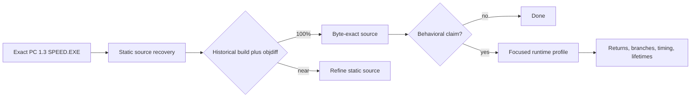

# NFSMW PC static recovery and runtime boundary

The PC 1.3 executable does not need runtime unpacking before source recovery. Its PE structure, imports, code anchors, and existing matching corpus are statically readable. Runtime is a behavioral validation layer: it is required for returns, branch selection, exact transitions, timing, lifetimes, and environment-dependent behavior, not for recovering ordinary code bodies.

## Findings

### F-001 Static source recovery can continue without running the game

- severity: n/a_re
- evidence_ids: E-001, E-002, E-004
- confidence: high
- location: PC 1.3 SPEED.EXE and matching C++ corpus
- status: validated

The exact sample is a readable PE32 i386 image with a rich import table and 48 validated code anchors. The current local objdiff report already attributes 4,183,974 code bytes and 46,126 functions, so the remaining mapped bodies are ordinary static source-recovery work rather than a runtime decryption problem.

### F-002 The strongest current static work queues are AI and physics behaviors

- severity: n/a_re
- evidence_ids: E-002
- confidence: high
- location: zAI and zPhysicsBehaviors PC source-list units
- status: validated

The dirty local snapshot reports zAI at 38.528877% exact bytes and 72.99011% fuzzy similarity, and zPhysicsBehaviors at 39.157555% exact bytes and 61.584644% fuzzy similarity. These units have the most useful combination of symbols, recovered source, exact anchors, and remaining non-exact code.

### F-003 Existing schema-3 evidence observes reachability but not outcomes

- severity: n/a_re
- evidence_ids: E-003
- confidence: high
- location: schema-3 AI survey capture
- status: validated

The existing survey saw 12 of 48 catalogue hooks and recorded 100,000 sampled entries. Because it is deliberately entry-only, it cannot establish function returns, successful spawns, exact state-transition instants, call duration, or unique lifetimes when allocator addresses are reused.

### F-004 Thirty-six statically locatable AI hooks still lack runtime observations

- severity: n/a_re
- evidence_ids: E-001, E-003
- confidence: high
- location: Tools/AI/RuntimeTrace/hook_catalogue.json
- status: validated

All 48 catalogue anchors validate against the exact executable, but the survey profile enabled only 12. The 36 remaining racer, traffic, pursuit, helicopter, navigation, and core hooks can be reconstructed statically now; focused runtime profiles are needed only to learn whether, when, and with what outputs they execute.

## Static versus runtime matrix

| Question | Static now | Runtime needed | Boundary |
|---|---|---|---|
| Function body, boundaries, constants, calls, loops | Yes | No | Confirm with historical compiler and objdiff |
| Class layout, vtables, field offsets | Usually | Corroboration for live complete-object offsets | Static stores/loads are primary; runtime samples validate instances |
| Imports and direct dependencies | Yes | Only for actual `LoadLibraryA`/`GetProcAddress` resolutions | Direct IAT is readable |
| Virtual/indirect target set | Partial to strong | Yes for targets actually selected | Vtables bound possibilities; runtime supplies frequency/reachability |
| Spawn/validation Boolean or pointer result | Body yes | Yes | Entry samples count attempts, not successes |
| Scheduler cadence, branch distribution, exact transition time | No | Yes | Requires exit/value/time-aware capture |
| Object lifetime and allocator reuse | No | Yes | Address counts are not instance counts |
| Controller/menu, device enumeration, mapping | Static body can be recovered | Yes | Existing AI profile has no DirectInput or frontend hooks |
| Asset, graphics, audio, physics outcome | Algorithms yes | Yes | Outcome depends on loaded data, frame state, drivers, and devices |

## Solve path

### P-001 Source-recovery decision flow

- path_type: solve
- evidence_ids: E-001, E-002, E-003, E-004

1. Bind every claim to the exact PC 1.3 hash and preferred-image VA using E-001.
2. Recover the C++ body and data layout from the executable, symbols, and existing corpus using E-002 and E-004.
3. Compile with the historical toolchain and classify the objdiff result as exact, semantic-near, or unresolved.
4. Stop when the question is static and the body is exact; otherwise design the smallest runtime profile for the unresolved behavioral claim under E-003's visibility limits.



## Reproduction

```bash
cd '/Users/tihan-nico/NFS MW Remaster'
/usr/local/bin/python3 Tools/AI/RuntimeTrace/validate_target.py \
  --target '/Users/tihan-nico/.codex/worktrees/1a8f/NFS MW Remaster/Library/PCDecompilation/nfsmw-pc-match/orig/SPEED_EXE_1_3/speed.exe' \
  --catalogue Tools/AI/RuntimeTrace/hook_catalogue.json
jq '{capture_identity,interpretation_boundary,hook_census}' \
  Tools/AI/RuntimeTrace/capture-20260912-205005-gameplay-analysis.json
jq '{all:.measures,zAI:(.units[]|select(.name=="main/Speed/Indep/SourceLists/zAI")|.measures)}' \
  '/Users/tihan-nico/.codex/worktrees/1a8f/NFS MW Remaster/Library/PCDecompilation/nfsmw-pc-match/build/SPEED_EXE_1_3/report.json'
```

## Limitations

No target was executed and no new instrumentation was installed. The current static measures come from a dirty local worktree and therefore describe an observed workspace snapshot, not a committed upstream state. The raw schema-3 event stream is absent; this case relies on the validated derived analysis JSON and its explicit interpretation boundary.
