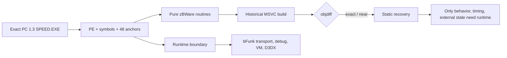

# zBWare reconstruction case report

## Scope

This is an authorized, offline static reconstruction of the PC 1.3 `speed.exe` sample and the matching `zBWare` SourceList. The case scope and authorization are recorded in [scope.md](../scope.md). The sample is a 32-bit Intel PE with image base `0x00400000`; its SHA-256 is recorded in E-001. No target execution, network access, binary patching, or external-state claim is part of this case.

## Outcome

The deterministic zBWare core now has source-level implementations for list/chunk helpers, fixed and floating-point math, vectors, quaternions, matrices, strings/shared strings, SpeedScript parsing wrappers, memory accounting, slot pools, printf setup, and bFunk packet headers. The translation unit builds in the historical MSVC matching configuration.

The focused object comparison reports `.text` fuzzy match `59.85073%` (`35235` bytes), `.rdata` `47.451748%`, `.data` `25.858124%`, and `.bss` `6.3682847%`. Key routines reach exact or compiler-near matches: `bList::Sort` and `bList::MergeSort` are `100%`, `bCalculateCrc32` is `67.69231%` with equivalent control flow, and `bInvertMatrix` is `85.52027%`. The regenerated full report records the unit-level zBWare fuzzy match as `59.901512%`, with `9121/35235` matched code bytes and `129/467` matched functions.

## Evidence chain

- E-001 fixes the exact retail sample identity and confirms 48 runtime-trace anchors without executing the sample.
- E-002 records the static source-to-symbol reconstruction inventory and the high-signal retail addresses used for recovery.
- E-003 records the successful object build and focused objdiff measurements.
- E-004 records the remaining platform/runtime boundary: bFunk transport/server paths, bDebug ticker/file checks, memory tracing/VM hooks, and the imported `d3dx9_26.dll` transpose routine.

## Static/runtime boundary

| Area | Static status | Runtime requirement |
|---|---|---|
| Containers, geometry, fixed math, strings, SpeedScript wrappers | Reconstructed in source; exact or semantic/compiler-near comparisons recorded in E-002/E-003 | None for algorithmic verification beyond tests |
| Memory-pool accounting and slot-pool integrity/free paths | Reconstructed where the PC target exposes deterministic behavior | Allocator/page layout and debug instrumentation need a live process |
| bFunk packet layout/accessors and return-header setup | Reconstructed from the local header and target call shape | Transport, server discovery, async dispatch, and checksum integration require runtime/platform state |
| bDebug ticker/file checker/interrupt hooks and VM/tracing | Source remains explicitly stripped or platform-specific | Requires the original runtime, OS services, or a controlled replacement |
| `bTransposeMatrix` | CPU fallback is implemented with alias-safe semantics | Retail imports `D3DXMatrixTranspose` from `d3dx9_26.dll`; byte parity requires that dependency/toolchain |

## Diagram

The case-local source for the diagram is [static-runtime-boundary.mmd](static-runtime-boundary.mmd).

## Findings

### F-001
- title: Deterministic zBWare core is statically reconstructed and buildable
- severity: info
- category: reverse_algo
- status: validated
- evidence_ids: [E-001, E-002, E-003]
- location: `src/Speed/Indep/bWare` and `src/Speed/Indep/SourceLists/zBWare.cpp`
- impact: The recovered source can be iterated and compared against the PC target without requiring target execution for the pure routines listed above.
- confidence: high
- repro_steps:
  1. Validate the exact PE sample and anchors using E-001.
  2. Rebuild the zBWare object and run the focused objdiff commands in E-003.
  3. Inspect the recovered routines and target addresses listed in E-002.
- remediation: n/a for pure reverse engineering
- optional_attack: 

### F-002
- title: Remaining zBWare behavior is platform/runtime-bound
- severity: info
- category: design
- status: validated
- evidence_ids: [E-002, E-004]
- location: `bFunkPlat.cpp`, `bDebug.cpp`, `bMemory.cpp`, and `bMatrix.cpp:bTransposeMatrix`
- impact: Static source recovery alone cannot establish transport behavior, server discovery, timing/debug services, VM hooks, allocator placement, or byte parity with the external D3DX implementation.
- confidence: medium
- repro_steps:
  1. Inspect the remaining STRIPPED/TODO inventory in E-004.
  2. Inspect the retail import table for `d3dx9_26.dll` and `D3DXMatrixTranspose`.
  3. Keep runtime validation as a separate authorized lab phase.
- remediation: n/a for pure reverse engineering
- optional_attack: 

## Paths

### P-001
- title: Retail sample to reconstructed zBWare callflow
- path_type: callflow
- start: Exact PC 1.3 `speed.exe`
- goal: Reproducible source-level zBWare implementation with an explicit runtime boundary
- steps:
  1. action: Identify the PE image, hash, architecture, and 48 validated anchors — evidence: E-001 — finding: F-001
  2. action: Map the zBWare SourceList to public symbols and disassemble high-signal pure routines — evidence: E-002 — finding: F-001
  3. action: Rebuild the historical MSVC object and compare sections/functions with objdiff — evidence: E-003 — finding: F-001
  4. action: Classify stripped/platform code and external D3DX imports as runtime boundaries — evidence: E-004 — finding: F-002
- residual_risks: Compiler/toolchain differences leave some matches semantic rather than byte-identical; live behavior, timing, external state, and transport integration remain unverified by this offline case.

## Timeline

See the append-only [timeline.md](../timeline.md) for scope review, reconstruction, match verification, and handoff events.
